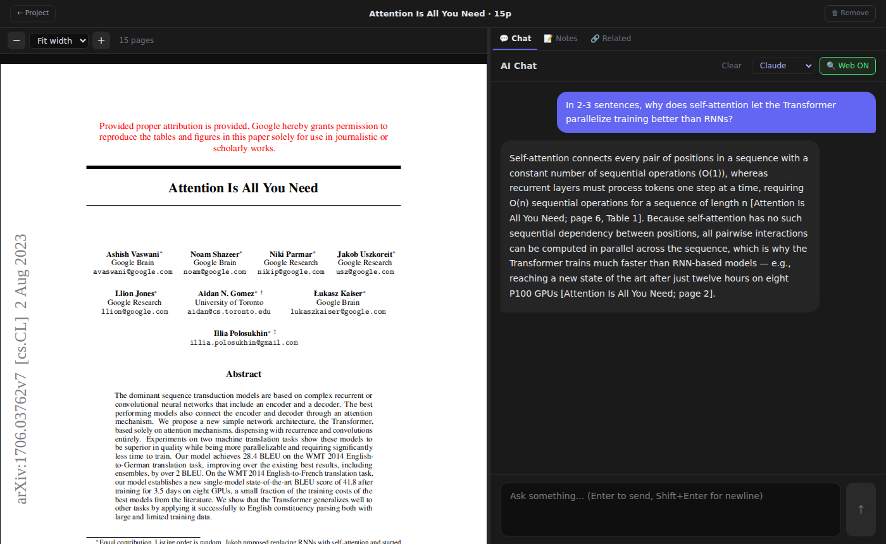
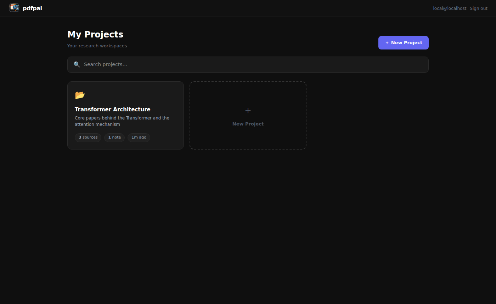
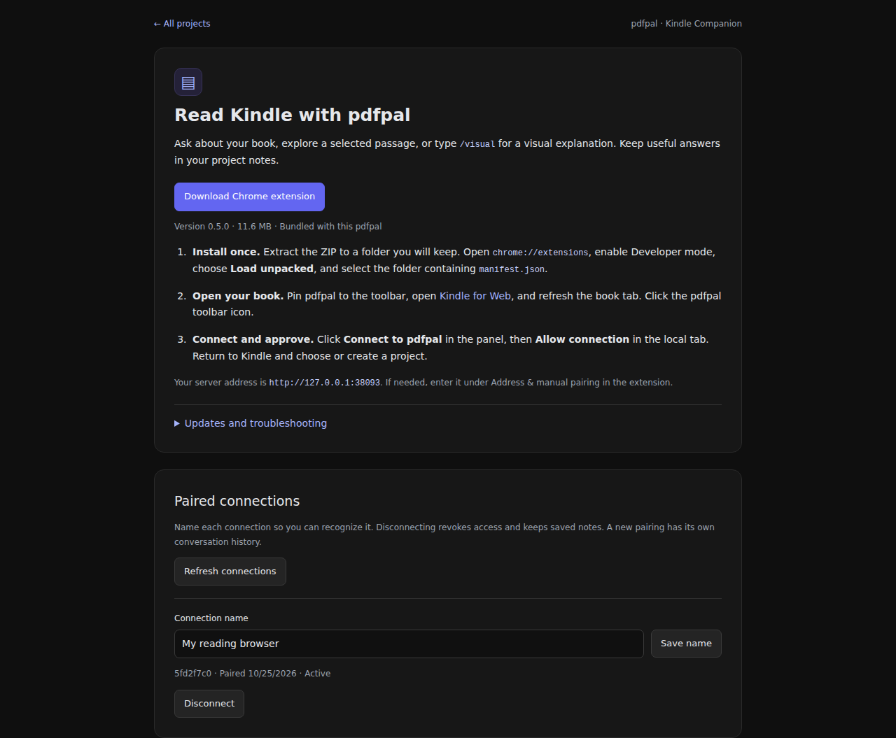
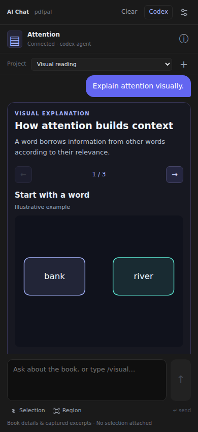
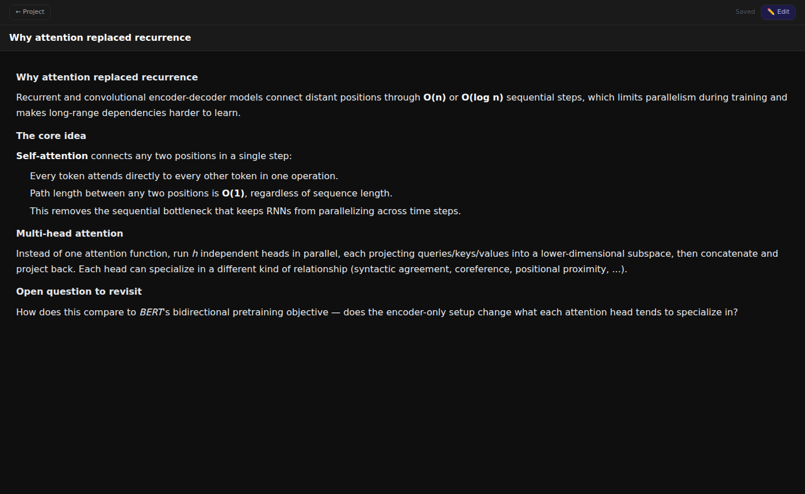
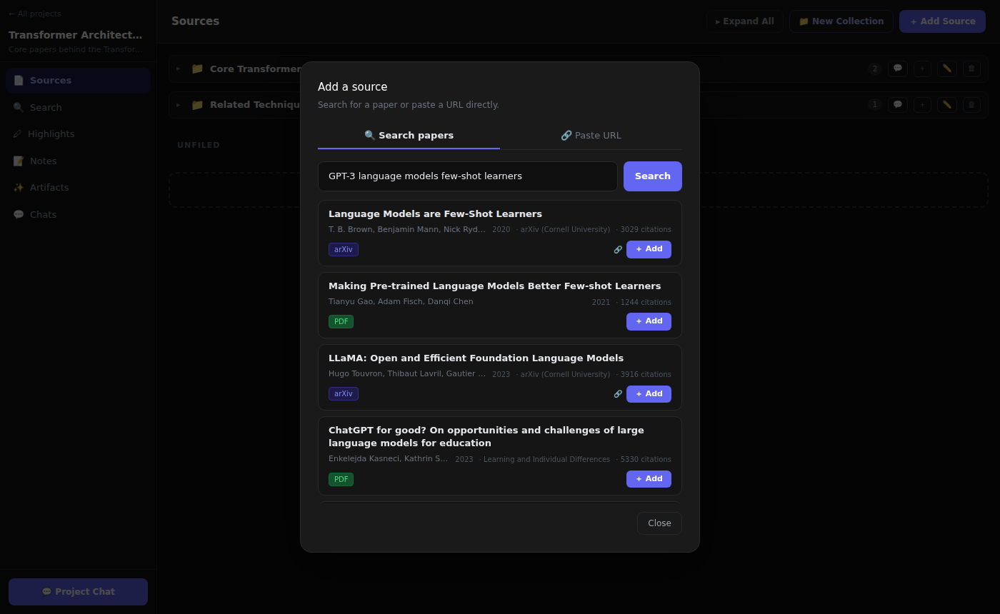
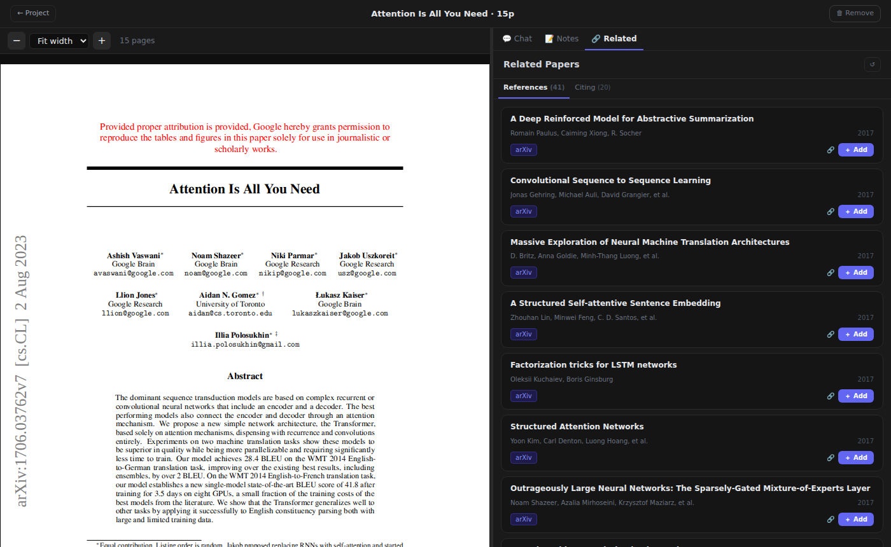
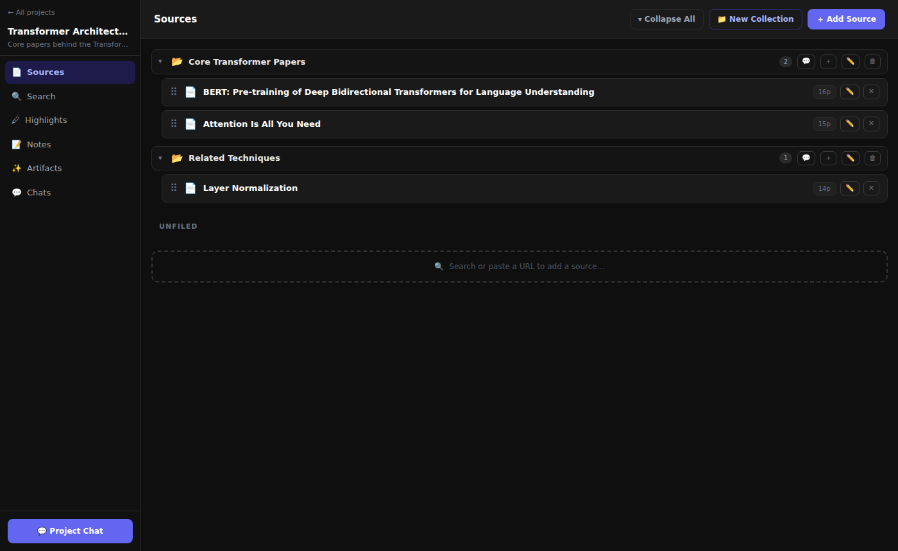

# pdfpal

> **AI to read deeper, not to avoid reading.**

A local reading assistant for PDFs and Kindle books, with AI chat, visual explanations, notes, and highlights beside the page. Use it as a **Windows desktop app** or as a **CLI and browser reader on Linux/WSL**. The optional Chrome companion brings the same reading tools to Kindle for Web.

Both installation options use the same reading and project core, with independent release versions. AI features use your configured assistant; there is no separate pdfpal account or subscription. Your provider’s authentication, charges, and usage limits still apply.

## Install and run

| Choose your setup | What you need | Get started |
| --- | --- | --- |
| **Windows desktop preview** | Windows 11 on an Intel/AMD 64-bit computer. No separate Node.js or Git installation for pdfpal. | [Install the Windows app](#windows-desktop-preview) |
| **Linux / WSL: CLI and browser reader** | Git and Node.js 22 or newer. | [Install from source](#linux-and-wsl) |

### Windows desktop preview

1. [Open the official GitHub Releases page](https://github.com/andrepaim/pdfpal/releases) and download the **pdfpal-Setup-…-x64.exe** installer from the newest Windows desktop release, marked **Pre-release**.
2. Run the installer, then open **pdfpal** from the Windows Start menu. If upgrading, quit the running app from its tray menu first.
3. In setup, choose **Claude Code** or **Codex**. Follow the install/sign-in actions if needed, then check the connection. You can also choose **Continue without AI**.
4. Create a project, import a PDF, and start reading. See the [PDF quickstart](#read-a-pdf) below.

Closing the window keeps pdfpal running in the system tray near the clock. Click the tray icon to reopen it; use **Quit** in its menu to stop the app.

The Windows installer is currently an **unsigned engineering preview**, so Windows may show an unknown-publisher prompt. See the [Windows guide](docs/windows-quickstart.md) for tray settings, upgrades, uninstall, and troubleshooting.

### Linux and WSL

Install **Git** and **Node.js 22 or newer**. For AI features, also install and authenticate a supported assistant CLI: `claude`, `codex`, or `opencode`.

Run these commands in your Linux or WSL terminal:

```bash
git clone https://github.com/andrepaim/pdfpal.git
cd pdfpal
npm ci
npm run build
npm start
```

`npm start` starts the local server at `http://localhost:8200` and opens the reader in your browser. To run without opening a browser, use `npm start -- serve --no-open`.

The CLI is currently installed from this repository; a release is **not yet available from the npm registry**. These source installation commands include the current reader and Kindle companion and do not install Electron or desktop build tooling.

From the checkout, run CLI commands with `npm start --`, for example:

```bash
npm start -- project list
```

To use the shorter `pdfpal` command shown in the CLI and agent examples below, optionally link it from the checkout:

```bash
npm link
pdfpal --help
```

Keep the checkout in place when using this link. AI features use your assistant’s existing authentication and provider allowance.

<div align="center">

| Read and chat, side by side | Your research, organized |
|:---:|:---:|
|  |  |
| Ask questions about the paper you're reading, with no tab-switching | Projects, collections, notes, and chat history, all in one place |

</div>

## Quickstart

### Read a PDF

1. Click **New Project** and give it a title.
2. Click **Add Source** and search by title, paste a paper URL (arXiv, OpenReview, ACL Anthology, PMLR, a DOI link, or a direct `.pdf`), or choose **Upload PDF** to import a local file up to 25 MB.
3. Open the source, select the passage you're stuck on to ask about it, or save it as a highlight.
4. Switch to the **Notes** tab and write what you understood in your own words as a markdown note; it renders as you read it back.
5. Ask a question across every source in the project from **Project Chat**.

Use **Dark pages** beside the reader's zoom controls for a dark page background and light text. The setting is remembered in your browser across documents and reloads. It also changes figure and photo colors; switch it off to view their original colors.

After following a reference link within a PDF, click **Back to citation** in the reader toolbar to return to your previous position and zoom. Follow several references and click it repeatedly to retrace your jumps.

### Read a Kindle book

1. Start pdfpal and choose **Extension** on the projects home page (or **Kindle extension** in a project).
2. **Download Chrome extension**, extract it to a folder you will keep, and open `chrome://extensions`. Enable **Developer mode**, choose **Load unpacked**, and select the extracted folder containing `manifest.json`.
3. Pin pdfpal to Chrome's toolbar. Open your book in [Kindle for Web](https://read.amazon.com/), refresh the tab, and click the pdfpal toolbar icon.
4. Click **Connect to pdfpal**. In the local tab that opens, click **Allow connection**, then return to Kindle. Choose or create a project.
5. Ask a book question, select a passage to attach it, or type `/visual <concept>`. Save useful passages and answers as project notes.

No pairing code is needed for this flow. Keep pdfpal running; if it stops, restart it and Retry. **Address & manual pairing** supports custom ports and the older code-based connection flow. The web **Extension** page also lets you name and disconnect paired connections.



Supported readers: `read.amazon.com`, `ler.amazon.com.br`, and `read.amazon.co.uk`, in desktop Chrome. English prose is the initial OCR target. This companion works with Kindle for Web, not the native Kindle PC application. See the [companion guide](extension/README.md) for capture, update, and troubleshooting instructions.

## Features

### Kindle reading

The [Kindle Companion](extension/README.md) brings the same dark chat pane to Kindle for Web. Ask about the open book, attach native selections or locally recognized image text, generate visual explanations with `/visual`, and save passages or answers as project notes. Conversations survive closing the panel and normal extension updates.

Keep books in a project with **Add Source → Kindle book**, or use **Book details → Add book to project** in the companion. **Open in Kindle ↗** launches the reader in a new tab and selects the associated project in the connected companion. These entries store book references; full Kindle text is not imported or indexed.

Book questions use title/author, previous discussion, and captured or saved excerpts. The full Kindle book is not imported. Relevant project PDFs can be included explicitly; a project does not need PDFs to support Kindle chat.



### Reading & Chat

- **Split-pane reader**: PDF viewer on the left, chat/notes/related on the right; resizable.
- **Reading progress**: remembers the last page read for every source and restores it automatically the next time you open the PDF.
- **Per-source chat**: persistent conversation history per paper, restored across sessions; renders math (KaTeX); web research is handled by the selected agent when supported.
- **Text selection → ask or highlight**: stuck on a passage? Select it and ask about it right there, grounded in the paper, or save it as a highlight.
- **Project chat**: ask across multiple sources at once, toggle which sources are in context, or scope to a single collection.

### Visual explanations

Select text in the PDF reader and choose **Explain visually** from its popup, or type `/visual <concept>` in the reader or project chat. Type `/` for a command suggestion; Tab completes `/visual`. With a passage attached, `/visual` alone explains that selection. The same command works in the [Kindle companion](extension/README.md#explain-visually). Your configured agent creates progressive diagrams with clickable details, captions, a text transcript and source labels. Expand the viewer, ask follow-ups, save the explanation to a project note, or export a self-contained HTML file for offline reading. Saved explanations reopen without another model call. Project chat also supports general-concept visual questions without PDFs using `/visual <concept>`.

### Organization

- **Projects**: workspaces for a research topic: sources, notes, chat history.
- **Collections**: nested folders for organizing sources within a project; drag-and-drop, Expand/Collapse All.
- **Notes**: markdown notes at the project or source level, rendered by default, edit in place:

  
- **Highlights**: every annotation across a project, grouped by source, one click back to context.

### Sources & Discovery

- **Paper search**: search OpenAlex by title, one click to add:

  
- **Related papers**: references and citations from Semantic Scholar, with an OpenAlex fallback when needed, one click to add:

  
- **Smart PDF resolver**: paste any URL: arXiv, OpenReview, ACL Anthology, PMLR, a DOI link, or a direct `.pdf`; tracking params stripped automatically.
- **Project-wide full-text search**: SQLite FTS5 across every already-indexed source.
- **Managed local copies**: PDFs are copied locally; falls back to the source URL if a managed copy is deleted.

### CLI & Agent Automation

- **Full CLI**: every action above is also a `pdfpal` command, with `--json` for scripting.
- **Claude Code / Codex skill**: let an agent drive projects, sources, collections, and notes directly (see below).

## Why pdfpal?

There's a lot of vibe researching going on. Feed the PDF to a chatbot and ask for the gist, watch the 20-minute YouTube explainer, skim an AI-generated summary, then walk away feeling like you read the paper. You didn't. The understanding that matters lives in exactly the parts the summary flattens: the assumptions, the derivation the author skipped, the limitation buried in section 6, the table that quietly contradicts the abstract. If your grasp of a paper ends where a summary does, you don't have one.

But the answer isn't to pretend it's five years ago: print the paper, read it alone, hit a wall on page 4 (notation you forgot, a step "left as an exercise", background the author assumes you have) and either suffer through it or quietly give up. That suffering was never the point. pdfpal is the middle ground: you read the actual paper, and AI sits next to the page, unpacking the passage you're stuck on, answering questions grounded in the text instead of vibes, keeping you reading instead of pretending.

There are plenty of chat-with-PDF tools: web apps where you upload a paper and ask questions, AI assistants bolted onto PDF readers, notebook tools that summarize your sources. If you've tried one, you know the pattern: a free tier capped at a couple of documents or a few dozen pages, and a paid tier that stacks one more monthly subscription on top of the Claude, Codex, or OpenCode plan you already pay for. And your library lives in their cloud, not on your machine.

Most of them are also built around the summary: upload, get the takeaways, move on. That's the vibe-researching workflow. pdfpal is built around the reader.

pdfpal keeps your library, notes, and history on your machine. Chat and visual explanations go through the agent CLI you've installed and authenticated, which sends the relevant context to its configured provider. Kindle OCR runs locally with bundled language data. pdfpal adds no subscription fee or artificial usage quota; provider terms and limits still apply.

It's also a CLI with the same project/source/collection model as the web app (the browser and the CLI call the same core code, nothing is reimplemented twice), plus a Claude Code / Codex skill that lets an agent drive the whole thing directly. Here's what that looks like end to end.

## Research with an agent, then read

Finding papers is legwork, and by now agents are better at it than we are: they sweep the literature, follow citation trails, and triage abstracts faster than anyone with twelve tabs open. Reading is the part that's still yours. So pdfpal splits the job: give an agent a topic and it searches on its own, drives the pdfpal CLI through the [Agent skill](#agent-skill-claude-code--codex), and hands you back a project with the papers already fetched, filed into collections, and ready to read.

1. **Ask an agent** (Claude Code, Codex, or anything that can load the skill):

   > Research recent approaches to efficient attention mechanisms, create a pdfpal project called "Efficient Attention", and add the best papers you find.

2. **The agent finds the papers with its own tools**, then drives the real CLI to build the project. This is genuinely what it runs, not a mockup:

   ```bash
   pdfpal --json project create "Efficient Attention"
   pdfpal --json source add <project-id> "https://arxiv.org/abs/1706.03762"
   pdfpal --json source add <project-id> "https://arxiv.org/abs/2009.06732"
   pdfpal --json collection create <project-id> "Core Papers"
   pdfpal --json source file <project-id> <source-id> <collection-id>
   ```

3. **Open it in the browser**, already organized into collections:

   

4. **Read and ask questions inline**, in the same reader shown above, right where the agent left off.

## CLI

The examples below use the optional `pdfpal` command from the [source setup](#linux-and-wsl). Without `npm link`, run them from the checkout with `npm start --` in place of `pdfpal`.

```bash
pdfpal project create "My Research"
pdfpal source add "My Research" https://arxiv.org/abs/1706.03762
pdfpal collection create "My Research" "Core Papers"
pdfpal source list "My Research"
pdfpal note create "My Research" -t "Summary" -c "Key findings..."
pdfpal ask "My Research" "Compare the main methods"
```

Commands accept a UUID or an exact case-insensitive title. Ambiguous titles are rejected. Add `--json` for machine-readable output. `pdfpal ask <project>` reads the question from stdin when the question argument is omitted.

## Agent skill (Claude Code / Codex)

`skills/pdfpal-cli/` documents the full CLI (flags, exit codes, selector rules) so an agent can drive it directly; see [Research with an agent, then read](#research-with-an-agent-then-read) above for what that looks like in practice. It does not search for papers itself; that's the agent's job, using its own tools.

From the source checkout, install it for both Claude Code and Codex (symlinks into `~/.claude/skills/` and `~/.codex/skills/`):

```bash
npm run skill:install
```

Run `npm run skill:uninstall` to remove the symlinks.

## Local data

Linux/WSL uses `~/.pdfpal` by default; the Windows app uses `%USERPROFILE%\.pdfpal`. Both store the same kinds of local data:

```text
~/.pdfpal/
├── config.json
├── pdfpal.db
├── files/       # managed PDF copies
└── backups/     # automatic pre-migration database backups
```

New PDFs are copied into `files/`, while extracted text and FTS chunks live in SQLite. If a managed PDF is removed and the source has a URL, the reader downloads and renders the remote PDF without recreating the copy.

Existing databases are migrated in place after an automatic backup. Override the data directory with `PDFPAL_DATA_DIR` or only the database path with `PDFPAL_DB`.

Windows and WSL use separate default libraries. Sharing a live SQLite library between them is not a supported preview workflow. Windows upgrades and uninstall retain your library.

## Configuration

Configuration precedence is command flags, environment variables, `config.json` in your library folder, then defaults. The default file is `~/.pdfpal/config.json` on Linux/WSL and `%USERPROFILE%\.pdfpal\config.json` on Windows.

```bash
PDFPAL_AGENT=claude       # claude | codex | opencode
CLAUDE_BIN=claude
CODEX_BIN=codex
OPENCODE_BIN=opencode
PDFPAL_MODEL=
PDFPAL_PORT=8200
PDFPAL_DB=
SEMANTIC_SCHOLAR_API_KEY=
```

`SEMANTIC_SCHOLAR_API_KEY` is optional. Semantic Scholar's unauthenticated API shares a small rate limit across every caller on your network, not just you. A [free key](https://www.semanticscholar.org/product/api#api-key-form) is scoped to your own app instead and raises the limit substantially. Used for Related Papers and clean titles for arXiv/DOI links.

Legacy `~/.pdfpal/config.env` is imported automatically on first TypeScript startup.

## Development and tests

```bash
npm run typecheck
npm test
npm run build
npm exec --workspace frontend -- playwright install --with-deps chromium
npm exec --workspace extension -- playwright install --with-deps chromium
npm exec --workspace frontend -- playwright test
npm run test:extension
npm run test:archive
npm run test:package
```

`npm run build` builds the server, web reader, and extension, and creates a reproducible ZIP in `extension/package/`. The server serves that matching ZIP from its Extension page. `test:package` installs a real tarball into a temporary prefix and exercises guided pairing, chat, and note saving outside the checkout. Extension browser tests use their workspace’s bundled Chromium; all automated AI calls use fixtures.

`npm test` runs Node's test runner through `tsx`, fails when no tests are found, and enforces the configured c8 coverage thresholds. Playwright starts the compiled Fastify server using an isolated temporary data directory. Set `PLAYWRIGHT_EXECUTABLE_PATH` to use a system Chromium installation.

### Project loops

Reusable agent workflows for this repository live in [`LOOPS.md`](LOOPS.md). [Loopy](https://signals.forwardfuture.com/loop-library/) is optional contributor tooling and is not required to build or run pdfpal.

```bash
npx skills add Forward-Future/loopy --skill loopy -g
```

Run the saved local test-quality workflow with:

```text
$loopy run the saved Local test-quality pass loop
```

## Architecture

The Windows desktop app, web reader, Kindle companion, and CLI share TypeScript services, local storage, and agent configuration. The desktop app hosts the reader and its local backend, with an Electron shell for the tray and Windows lifecycle. The web reader uses the same-origin Fastify API; the extension uses a loopback bridge with revocable credentials; the CLI calls services directly. Kindle conversations are scoped to connection, project, and book, separately from PDF chat sessions. Saved notes are available in the project UI.

```text
Web reader ── HTTP ──▶ Fastify API ──┐
Kindle companion ────▶ Local bridge ─┤
                                    ├── TypeScript services
pdfpal CLI ─────────────────────────┘       │
                                            ├── SQLite, retrieval, notes, history
                                            ├── Managed PDF copies and extracted text
                                            ├── Claude / Codex / OpenCode agents
                                            └── OpenAlex / Semantic Scholar
```

### Main data paths

- **Ingest**: `SourceService` resolves a local file or URL, extracts its text, stores a managed PDF copy, and chunks/indexes the text in SQLite FTS5.
- **Ask**: `ChatService` scopes retrieval by project, source, or collection, builds a grounded prompt from matching passages, invokes the selected agent CLI, and persists the answer and source references.
- **Use**: React pages call the Fastify API; CLI commands and [`skills/pdfpal-cli`](skills/pdfpal-cli/) automate the same core operations. An agent subprocess may use its own web-search tools when supported by that agent.

The implementation follows that split:

- [`desktop/`](desktop/) contains the optional desktop shell, installer tooling, and Windows acceptance checks. See the [desktop build guide](desktop/README.md) and [automatic release pipeline](docs/windows-release-pipeline.md).
- [`extension/`](extension/) contains the Chrome side panel, reader capture, bundled OCR, and guided connection flow.
- [`frontend/src`](frontend/src/) contains the reader, chat, projects, notes, collections, and source-discovery UI.
- [`src/server`](src/server/) exposes the HTTP API and serves the built frontend.
- [`src/cli`](src/cli/) defines the scriptable `pdfpal` commands.
- [`src/core`](src/core/) owns projects, sources, collections, notes, retrieval, chat, PDF handling, configuration, and agent invocation.

The 2.1.0 package build contains the compiled TypeScript server/CLI, built React frontend, unpacked Chrome extension, and matching ZIP with bundled OCR assets. Runtime state stays local in the [library folder](#local-data), while external network edges are limited to source URLs, OpenAlex, Semantic Scholar, and capabilities provided by the selected agent. It is intended for local, single-user operation.

*AI to read deeper, not to avoid reading.*
