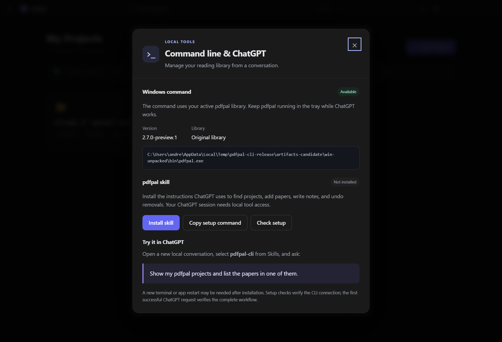

Windows CLI and skill verification — 2.7.0-preview.1

The packaged Windows app and its console launcher were exercised against isolated libraries and profiles. The user's regular library was not used for mutation tests. The native driver is `desktop/scripts/windows-cli-check.mjs`, also run by the Windows installer workflow.

The [native receipt](windows-cli-native.json) records checks for bundled execution without system Node, runtime/library binding, forty independent CLI invocations, literal Unicode arguments, idempotent writes, PDF import and content deduplication, bounded text retrieval, search, UTF-8 notes, Undo, verified full backups, PowerShell/cmd output, JSON argument files, WSL arguments/stdin, managed skill installation from ASAR, and the setup dialog/IPC.

Windows testing exposed host TCP resource exhaustion (`ENOBUFS`), with over 15,000 established TCP connections. The Windows command channel now uses a private named pipe and passed the forty-process test plus the full workflow under that host condition. The existing reader remains on its local HTTP service. No Windows network settings or unrelated services were changed. The runtime proves ownership with an HMAC challenge before receiving the CLI credential; authenticated commands retain library and instance checks.

Backend tests cover receipt rollback/replay/expiry, interrupted operations, wrong-library refusal, bounded text, note concurrency, real shared sync-outbox writes, and private-channel route scope. Browser tests cover installation versus connection status, live library refresh, and preserving a draft when another client edits a note. Existing browser and desktop regression suites remain required release gates.

The native workflow uses the same adapter and commands available to a ChatGPT/Codex skill. At packaging, a fresh ChatGPT conversation's automatic skill discovery and UI selection had not been verified in that host; CLI/adapter success was not proof of that UI step. The Windows skill installer and this workspace's existing WSL skill link both point to the updated instructions.

Follow-up on 2026-11-05 verified the actual Windows ChatGPT app (26.1029.7803.0). Its Skills page initially showed only five system skills. The app's agent environment was WSL in the Ubuntu distribution, where the skill was absent; the earlier Windows-agent discovery check and this workspace's Ubuntu-24.04 installation used different environments. Linking Ubuntu's `~/.agents/skills/pdfpal-cli` to the existing managed Windows skill made **Pdfpal CLI** appear under Installed with its checkmark on the actual app screen. The skill's adapter, executed in Ubuntu, then verified the `windows-pipe` connection and read all five regular-library projects. No agent environment or permission settings were changed, and no application restart was required. Selecting the skill for a new conversation and completing a model request remain separate from this catalog and CLI verification.

The [GitHub release workflow](https://github.com/andrepaim/pdfpal/actions/runs/42035846949) passed its regression, emulator, Windows installer and publication gates for source `ea47a07759554a4794bae851d4114e403d90a020`. [The official 2.7.0-preview.1 installer](https://github.com/andrepaim/pdfpal/releases/tag/desktop-v2.7.0-preview.1) was downloaded, checked against its SHA-256 manifest and installed over the regular Windows application.

Post-installation verification confirmed schema 14 → 15, unchanged raw fingerprints for every original library table and all 44 managed files, the same Google account/cloud library, and successful sync with no pending changes or conflicts. Windows command discovery resolves to the bundled launcher, its managed skill is installed, and commands use the private pipe. This agent session then followed the updated WSL skill to read the regular library: five projects and 38 sources. The local suite passed 168 tests with one emulator-dependent skip, all 80 browser tests passed, and all 36 desktop tests passed; GitHub separately passed the emulator gate.

