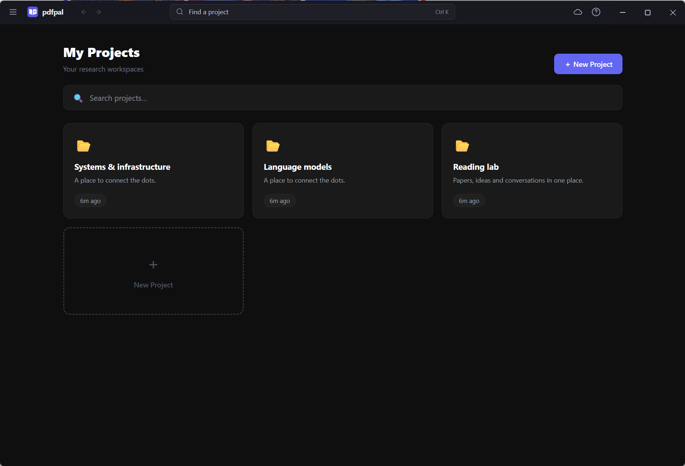

# Windows shell refresh

The 2.6 preview replaces Electron's default Windows title bar and File/Edit/View menu strip with a 44-DIP dark toolbar. Native caption buttons, resizing, dragging, Snap and close-to-tray behavior remain Windows/Electron controls. The app menu gives access to settings, library recovery, privacy, extension setup, zoom, updates and Quit; F10 opens it. Ctrl+K opens a project finder with arrow/Enter navigation. History navigation refuses startup/recovery documents and pages outside the active local reader origin. Navigation flushes pending saves before leaving the current view.

The browser interface and the native frames on other platforms retain their layouts. Windows-only shell activation is explicit in the protected preload bridge. All new native IPC passes the existing owned-top-frame/origin gate and accepts a fixed action allowlist. No arbitrary native commands, paths or URLs are accepted by the window controls.

## Verification

- Core suite: 155 reported tests, 154 passed and one emulator-only case skipped in the ordinary run; coverage passed.
- Browser suite: 77 passed, including custom menu focus/keyboard behavior, project finding, settings access, minimum-size window layout, and existing reading/editor regressions. The keyboard-focused shell cases were rerun after the shortcut implementation was finalized.
- Desktop suite: 36 passed, including native-frame configuration, history boundary checks, and preservation of editing/AltGr/Alt+F4 shortcuts.
- Isolated Windows Electron execution with synthetic research projects: title-bar rendering without a duplicate page header; Ctrl+K project finding; Ctrl+A text selection; native reading-history navigation, zoom, full screen and graceful Quit all passed. The test profile/library are independent of the regular installation.
- Actual Windows client-area capture verified the integrated native minimize/maximize/close buttons. Capture used the Windows client rectangle with explicit DPI awareness; the screenshot below contains synthetic projects only. Page screenshots alone do not include native caption overlays.
- The startup/recovery document has a matching draggable title area; the native buttons remain available while the backend starts or recovers.

The normal window close button still hides to the tray. Use **pdfpal menu → Quit pdfpal**, **Ctrl+Q**, or tray **Quit** to save and stop the backend. This change adds no new cloud services and does not change telemetry consent or PDF Storage configuration.
