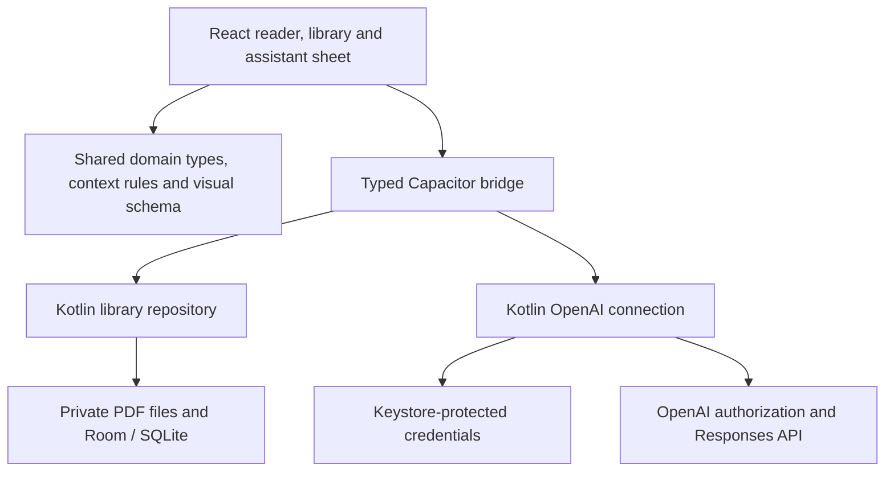

# pdfpal for Android: standalone reader and implementation plan

Status: proposed implementation plan; no mobile application has been implemented by this document.

Date: 2026-11-03. Decisions confirmed by the user: **Android first, standalone on the phone, OpenAI only, using supported ChatGPT subscription access.**

## Product direction

Read the actual paper on a full-screen canvas. When a passage becomes difficult, select it and bring up a small assistant sheet. Understand the passage, dismiss the sheet, and continue at exactly the same place.

The promise is: **Your papers on your phone. Help with the hard parts, using your eligible ChatGPT plan.** Reading, organization, highlights, notes, and saved explanations work offline. New AI requests require connectivity and the user's authorization to use their ChatGPT plan. pdfpal adds no subscription; OpenAI eligibility and usage limits apply.

This preserves the reason for pdfpal: summaries often remove precisely the assumptions, missing derivations, and limitations a reader needs to understand. Reading alone and getting stuck is avoidable too. The mobile home screen should help someone resume reading; importing a paper must never automatically generate a summary or spend AI allowance.

The first version is an independently installed Android app. It owns its library and credentials on the phone. A running desktop, terminal, Codex installation, pdfpal server, or pdfpal cloud account is not part of setup.

## First release scope

| Area | First Android release | Later |
| --- | --- | --- |
| Reading | Local PDFs, continuous vertical pages, zoom, search, contents, page navigation, precise resume | Reflow, EPUB, native Kindle capture, OCR for scanned documents |
| Assistance | Passage questions, follow-ups, visual explanations, source-page links | Voice, general agent tools, automatic whole-library research |
| Organization | Projects, nested collections, sources, highlights, Markdown notes, saved conversations | Automatic desktop sync, shared libraries |
| Accounts | Official OpenAI subscription authorization and account selection | Other providers, API-key billing, on-device models |
| Storage | Managed local PDFs, native database, explicit backup and restore | Cloud backup service, background synchronization |
| Devices | Android phones, portrait and landscape; usable single-pane tablet layout | iPhone, tablet split view, desktop mobile companion mode |
| Distribution | Signed Android preview APK, then Google Play testing/release | Other app stores, iOS distribution |

## Experience

### Library and opening a paper

The first screen emphasizes **Continue reading**, followed by projects and recent papers. A single Import PDF action opens Android's document picker. Also accept a PDF shared from another Android app. Allow reading before connecting ChatGPT; offer connection when the reader first asks for help or opens AI settings.

Copy an imported document into app-managed storage, validate that it is a PDF, compute a content hash, and create the source atomically. Show opening/indexing progress without waiting for the whole document to be indexed before displaying page one. A duplicate offers **Open existing** or **Add another copy**. A failed or cancelled import leaves neither a broken source nor an orphaned permanent file.

Use the system picker for import and export rather than asking for broad storage access. Android's Storage Access Framework exposes user-selected document URIs, including documents from installed providers. The app must complete its local copy before claiming offline availability. [Android document access](https://developer.android.com/training/data-storage/shared/documents-files)

### Reader

The PDF fills the available screen. A compact top bar contains Back, document title, and More. A discreet page indicator opens page navigation; More contains search, contents, highlights, notes, and document details. Chrome can fade while reading, but actions remain available through accessible controls. There is no permanently visible sidebar or chat transcript.

Preserve page geometry and equations. Default to fit width; allow pinch zoom and horizontal panning when zoomed. Save page, normalized viewport anchor, and zoom after movement settles. Restore the anchor after page layout is ready, including after rotation or returning from another app. A tap that clears a selection must not also unexpectedly hide navigation.

### Select, understand, continue

Long-press uses Android's text-selection handles. Once selection settles, offer **Ask**, **Explain visually**, and **Highlight**. Retain native Copy and accessibility behavior. Capture the selected text, page numbers, and normalized rectangles before opening the keyboard or moving focus.

**Ask** opens the assistant sheet with a compact quotation and page reference. The input suggests a concrete question such as “Explain this step.” It does not send until the reader taps Send. **Explain visually** opens the same context with a proposed visual request and a Generate action. The first request explains what context will be sent to OpenAI; later requests retain an expandable context preview.

Use one bottom sheet with three positions:

| Position | Behavior |
| --- | --- |
| Peek | Small handle and status; the paper remains readable. A running answer can continue while the reader looks back at the passage. |
| Half | Approximately 45% of usable height, adjusted for the keyboard. Shows the question, response, and composer while keeping the selected passage visible where possible. |
| Full | Expanded conversation or visual explanation with an explicit **Back to paper** action. |

Half-height is the default when there is enough room. With a keyboard on a short screen, expand the sheet instead of compressing both the paper and input into unusable slivers. Dragging belongs to the sheet handle; scrolling a response belongs to its content. At partial height, the remaining paper stays interactive. At full height, manage focus as a modal.

Android Back first dismisses the keyboard, then reduces/closes the sheet, then navigates away from the document. Closing the sheet preserves its draft and conversation; it does not discard a running request. A visible Stop action cancels generation. Returning to the paper restores the reader's previous position, apart from an explicit citation jump.

If another passage is selected, show **New question about this selection** instead of silently changing the context of an existing conversation. Every turn retains the context that was actually sent. Citation jumps temporarily mark the referenced passage and offer a return to the prior reading position.

### Visual explanations

Reuse pdfpal's structured visual format: short scenes, readable labels, selectable details, and references back to the selected passage. On a phone, show one scene at a time with a clear progress indicator. Expand diagrams into the full sheet with pan/zoom only when necessary; provide equivalent explanatory text for TalkBack. Save a successful visual locally with its passage and source pages.

Generate diagram data as model text and validate it against the shared schema. Render with the existing controlled SVG components. This does not require OpenAI's image-generation tool, which the subscription route currently excludes. Never execute generated HTML or JavaScript. If validation fails, preserve the textual explanation and offer an explicit retry; avoid unbounded automatic repair requests. [OpenAI preview limitations](https://developers.openai.com/siwc/token-sharing-open-source/preview-limitations)

Use real reading tasks for prototypes and promotional screenshots:

- In *Attention Is All You Need*, select the decoder's shifted output embeddings passage and ask why shifting is necessary despite causal masking. Show a three-token example that makes the information leak visible.
- In a separate selection, use the scaled dot-product attention discussion and ask why dividing by the square root of the key dimension prevents saturated softmax. Show how increasing dimension changes logit spread and attention weights, labeling illustrative values as examples.

These are different passages with different questions. Neither should become a paper-summary demo. Record the source, page, exact selection, prompt, model, and actual response used for screenshots.

### Important states

| State | Reader behavior | Assistant behavior |
| --- | --- | --- |
| Offline | Read, search indexed pages, annotate, edit notes | Saved responses available; retain draft and explain that new requests need a connection |
| Not connected | Fully usable | Continue with ChatGPT; return to the same selection after sign-in |
| Permission declined or account ineligible | Fully usable | Explain the missing permission/eligibility and allow retry; no API-key fallback or hidden billing change |
| Generating | Continue reading or inspect passage | Stream response, show Stop, preserve request context |
| Limit reached | Fully usable | Keep partial content marked incomplete; link to ChatGPT usage controls |
| Interrupted by process death/network loss | Restore local reading state | Mark unfinished work interrupted; user chooses whether to resend |
| PDF has no usable text | Render available pages | Explain the selection limitation; manual questions and explicit page-image context remain possible where supported |
| Corrupt or unsupported encrypted PDF | Explain why opening failed | Do not create a misleading usable source |

## OpenAI integration

### Supported route and first feasibility gate

Use **Sign in with ChatGPT → eligible Responses API requests**. OpenAI documents plan usage for open-source clients without a partner API key or client secret. Eligible accounts can authorize use of their plan; this is distinct from ordinary API-key billing and does not import their ChatGPT conversation history. Label sign-in **Continue with ChatGPT** and follow OpenAI's branding rules. [OpenAI quickstart](https://developers.openai.com/siwc/quickstart)

The documentation currently describes an HTTP loopback callback, not an Android App Link or arbitrary custom URI scheme. Therefore Android compatibility is an explicit M0 acceptance gate, not an already verified product capability. Implement a short-lived native listener bound only to `127.0.0.1`, launch the system browser, and test the complete round trip on physical Android devices. Do not register the desktop Codex client, copy its credentials, or substitute an undocumented endpoint if this fails. Resolve the supported mobile flow with OpenAI before treating AI delivery as unblocked.

Follow the official registration contract: persist a host ID, use dynamic registration initially, retain the issued client ID, use fresh PKCE/state/nonce, validate callback state and ID-token identity, and verify the granted plan-usage scope. Reauthorization retains the registration and exact callback path; the documented port flexibility does not allow changing callback hosts. All of this belongs in Kotlin, including token exchange and validation. Close the callback listener on success, cancellation, timeout, or failed validation. [Registration and sign-in](https://developers.openai.com/siwc/token-sharing-open-source/sign-in)

### Credentials and accounts

Keep account registrations separate, including when their displayed email matches. Show the active account in Settings and next to model selection. A changed account takes effect for subsequent requests; existing conversation history remains local and is not automatically transmitted to the newly selected account.

Serialize token refresh per registration and atomically replace rotating credentials. Sign-out stops requests, attempts remote session revocation, and clears local tokens. If remote revocation cannot be confirmed, explain this and link to ChatGPT settings. Preserve the registration mapping for later sign-in, unless the user explicitly removes it. Direct users to OpenAI's usage settings rather than inventing a remaining-credit counter. [Accounts and sessions](https://developers.openai.com/siwc/token-sharing-open-source/profiles-and-sessions)

Encrypt credential records in private native storage with an Android Keystore key. The Keystore protects cryptographic key material; tokens themselves are encrypted application data. Tokens must never cross the JavaScript bridge, enter browser storage, appear in logs, or be included in library backups. Reinstallation/restoration creates a fresh installation identity and requires sign-in. [Android Keystore](https://developer.android.com/privacy-and-security/keystore)

### Requests and completion

Fetch the account-specific model catalog with its OAuth token, preserve the provider's order and display names, and persist only a still-available selection. Call the public Responses endpoint with `store: false` and `stream: true`. Native code parses SSE and emits bounded response events to React. Mark success only on `response.completed`; a stream ending or producing some text is insufficient. Limits can arrive after output has begun. [Models and inference](https://developers.openai.com/siwc/token-sharing-open-source/models-and-inference)

Build each request from explicit input and local history. Follow the preview's field restrictions, including omitting `previous_response_id`, `conversation`, `background`, and `max_output_tokens` on this HTTP route. Use developer instructions rather than unsupported system-message input items. Avoid the Files upload API and hosted retrieval. Support text first and explicit page crops only for a compatible model. Verify structured-output options in M0; schema-guided text plus local validation remains the baseline. [Preview limitations](https://developers.openai.com/siwc/token-sharing-open-source/preview-limitations)

The native AI bridge allows only the required OpenAI endpoints, structured input, cancellation, and status events. It exposes no arbitrary authenticated HTTP proxy or filesystem tool. Default retries must not replay inference automatically after ambiguous delivery, process death, or a partially received response. Preserve partial text with an incomplete label and offer a deliberate Retry action. Authentication refresh may be retried before sending a new inference request.

### Reading context and privacy

The context builder starts with the selected passage, its page text, relevant neighboring text, the reader's question, and the necessary conversation turns. Retrieve additional chunks locally when the question needs them. Bound context to the selected model's supported input budget and reserve space for the answer; if model limits are unavailable, use a conservative tested budget and offer a narrower context. Show included pages in the sheet. Do not silently attach the whole library.

Extract text locally with the bundled PDF engine. For equations, tables, or figures with poor extraction, let the reader preview and attach a cropped page image explicitly; verify model capability first. Treat paper content as evidence, not instructions to the app. Require source-page references when answering about the paper and distinguish the paper's claims from an explanatory example.

PDFs, notes, history, and saved visuals live on the device. Authorized request context goes directly to OpenAI and is subject to its policies. `store: false` is a request requirement, not a claim that the provider never retains any operational data. No pdfpal proxy, account service, automatic telemetry, or background document upload is required.

## Architecture and reuse

Use **Capacitor with the existing React/PDF.js UI, plus Kotlin platform adapters**. Capacitor supports adding a native runtime to an existing web build. This is a proposed architecture that must pass the physical-device reader and authentication gates below. [Capacitor installation](https://capacitorjs.com/docs/getting-started)

The app bundles its assets and works without a website. Android handles durable storage, file access, account credentials, browser authorization, network streaming, and lifecycle integration. React handles the reader, sheet, library screens, and visual rendering. The loopback OAuth callback exists only during sign-in; there is no permanent local application API server.

| Current code | Reuse or change |
| --- | --- |
| `frontend/src/components/PdfViewer.tsx` | Reuse PDF rendering and normalized annotation geometry. Replace mouse-only selection and permanently retained rendered pages for the mobile surface. |
| `frontend/src/App.tsx` | Add a mobile shell and sheet controller. Keep the desktop split layout behind its existing runtime. |
| `frontend/src/components/ChatPanel.tsx` | Extract conversation presentation and draft state from HTTP/agent selection dependencies. Mobile uses OpenAI accounts and native streaming. |
| `frontend/src/components/VisualExplanation.tsx`, `src/shared/visual.ts` | Share schema and safe rendering; add phone scene navigation, readable labels, and full-sheet mode. |
| `frontend/src/lib/api.ts` | Introduce a typed application gateway with existing HTTP and new native implementations. Avoid scattered platform checks in components. |
| `src/core/database.ts`, `sources.ts`, `chat.ts`, `visual-explanations.ts` | Preserve domain semantics and extract pure policies where useful. Node filesystem, `better-sqlite3`, and service construction cannot run unchanged on Android. |
| `src/core/agents.ts` | Retain for desktop/CLI. Android calls the documented OpenAI flow directly and does not bundle command-line agents. |
| `frontend/src/lib/persistence.ts` | Add continuous/debounced persistence and Android lifecycle hooks; do not depend on unload completing. |

Proposed boundaries: `LibraryRepository`, `DocumentStorage`, `ReadingStateStore`, `AccountConnection`, and `ReadingAssistant`. Keep the interface focused on operations such as import, query sources, save annotation, read PDF range, ask, cancel, and observe request status. Large PDF byte buffers must not repeatedly cross a JSON bridge; use app-private resource handles/range access with path traversal checks and streaming native copies.

Suggested placement: `mobile/` owns Capacitor configuration and the Android project; `frontend/src/mobile/` owns phone navigation/sheets; `frontend/src/platform/` owns gateway selection; `src/shared/` holds portable contracts and pure rules. Confirm build roots and TypeScript imports in M0, without an unrelated monorepo restructure.

Use Room with bundled SQLite and FTS5 for native data access, pinning a verified compatible release in M0. Current Room documentation describes FTS5 and bundled-driver support. Maintain mobile migrations independently instead of feeding desktop migration SQL blindly into Room. Search behavior and query escaping must pass shared fixtures even if implementation details differ. [Room full-text search](https://developer.android.com/training/data-storage/room/defining-data)

The reason to start with this architecture is the existing investment in PDF selection geometry and visual rendering. A full native or React Native rewrite is more work before validating the core interaction. If WebView selection or rendering cannot meet M0 criteria, prototype a native PDF surface before committing to M1; do not ship a poor reader to preserve code reuse.

## Local data and lifecycle

Retain the existing project/source/collection model, with notes, annotations, conversations, messages, and visual explanations. Add a reading anchor, indexing state, account reference per AI turn, and request lifecycle fields. Selection context includes immutable source ID, file hash, page ranges, quoted text, normalized rectangles, and any explicitly approved image crop. A saved explanation remains associated with the original source even if the reader switches documents.

Import uses a temporary file, validated metadata, and a transactional publish step. Index pages in resumable batches; interruption must not make already imported pages unreadable. Cache extracted page text separately from render canvases. Search indicates when indexing is partial. Serialize database writes through the native repository and test migrations with real old-schema fixtures.

Persist drafts and reading state while the app is active. Save a request record before starting network work, then checkpoint received text periodically and on terminal events. A process restart marks nonterminal requests interrupted. Closing a sheet may keep work running while the app is active, but v1 does not promise generation will finish while Android suspends or kills the app. Avoid a foreground service solely to keep chat alive.

Export a versioned archive containing PDFs, a manifest, portable records, Markdown notes, annotations, conversations, visuals, and checksums. Exclude credentials, temporary images, and rebuildable indexes. Restore validates archive paths, sizes, hashes, and format version into staging, then commits atomically. Offer new-project import to avoid overwriting an existing library. This is a backup format first; desktop import compatibility requires its own adapter and tests, so it is not advertised as sync.

Disable automatic OS cloud backup of the private library and credentials for the initial local-only promise; expose explicit export in Settings and before destructive library operations. Uninstall removes app-private data, so onboarding/settings must make the backup path discoverable. A user can deliberately export through a cloud document provider without pdfpal operating a cloud service.

## Reader performance and accessibility

The current lazy PDF pages remain rendered after first exposure. On mobile, use a bounded page window, preserving measured placeholder heights as canvases are evicted. Start with the visible pages plus up to two neighbors, adapt to page size, cap raster pixel budgets, cancel obsolete renders, and release canvases/bitmaps. Do not unload the page containing an active selection until its geometry is captured. Test rotated pages and mixed page sizes.

Handle `selectionchange` and stable touch selection rather than only `mouseup`. Verify that selection handles, native context actions, custom actions, page scrolling, and pinch zoom cooperate in the actual Android WebView. Capture selection rectangles in PDF coordinates so they remain correct across zoom and rotation.

Use native window/keyboard insets with viewport information for sheet sizing. A keyboard resize must not move the paper's saved anchor. Support gesture navigation and three-button navigation. Respect system font size, reduced motion, contrast, TalkBack labels and reading order, external keyboards, and at least 48 dp touch targets. Full-screen visuals must have a text alternative.

Proposed support baseline: Android 12 or newer, a maintained Android System WebView, 4 GB RAM reference phone, widths from 360 dp, portrait and landscape. This is pdfpal's proposed support scope rather than Capacitor's minimum. Pin compile/target SDK and toolchain versions during M0 and verify store requirements again before release.

Performance acceptance targets, to be measured rather than advertised as achieved: first readable page of a local 25 MB reference PDF within 3 seconds on the reference phone; sheet opens within 150 ms without network dependence; warmed local search within 500 ms on a 1,000-page test library; 100-page scrolling does not retain 100 canvases or show sustained memory growth after returning to the start. Record device, WebView, build, timings, peak memory, and PDF fixtures. Also stress a 500-page document and image-heavy pages; failure must be recoverable without losing local edits.

## Milestones and acceptance gates

Estimates are engineering effort for one experienced developer, excluding external approval, tester availability, and store review. M0 determines whether later estimates remain credible.

| Milestone | Work and deliverable | Exit criteria | Estimate |
| --- | --- | --- | --- |
| M0: prove the two critical paths | Disposable Android build with real PDF selection/sheet, bounded rendering prototype, native OAuth callback, token refresh, account model list, text request, and schema-based visual request | Physical-device evidence of official sign-in and completed inference; no desktop/backend; selection remains usable with keyboard; acceptable long-paper memory; supported dependency versions recorded | 3–5 days |
| M1: standalone library | Application gateway, native Room/files repository, import/share intent, projects/collections, local page text/search, reading resume, migrations and backup skeleton | Airplane-mode import/read/reopen/search; no orphaned files after cancellation; process-kill and low-storage recovery; desktop checks stay green | 5–8 days |
| M2: reader and contextual sheet | Production touch selection, annotations, three sheet positions, drafts, citation jumps, Android Back, keyboard/rotation handling, accessibility | Repeated select → ask → return preserves page/zoom; no sidebar on phones; TalkBack and large text tasks pass on hardware | 5–8 days |
| M3: subscription assistance | Harden native accounts/refresh/revocation, SSE lifecycle, context assembly, follow-ups, local history, saved visuals, explicit page crops | Real passage questions and visuals pass; limits/401/partial-stream/process-death paths preserve work; no unintended resend or credential leakage | 5–8 days |
| M4: release readiness | Complete backup/restore, migration tests, performance profiling, adaptive icons, signed APK/AAB pipeline, help/privacy copy, preview cohort | Restore/upgrade verified, reference-device targets met, all essential offline/online tasks pass, no critical data-loss/auth bugs | 5–7 days |

Total initial estimate: **23–36 engineering days**, approximately five to eight working weeks before store-review time. Auth support or a native PDF-renderer replacement can change that estimate. M1 and reusable UI design can proceed while an external auth issue is resolved, but do not label the standalone AI product ready until M0's real authorization gate passes.

### M0 evidence checklist

- Install on at least one midrange physical phone and a second Android/browser combination; use emulator coverage in addition.
- Read and select both real-paper examples above; test multi-line, two-column, equation-adjacent, rotated, and cross-page selection. If cross-page selection is unreliable, ship an explicit one-page selection boundary with adjacent context instead of corrupt text.
- Exercise first sign-in, cancellation, declined permission, return from browser, app backgrounding, listener timeout, reauthorization, refresh rotation, sign-out, and revoked access. Verify the account-specific model list and a real terminal completion event.
- Confirm native callback behavior under current Android browser restrictions. Record whether foreground lifecycle handling is sufficient; any required service must be justified before expanding architecture.
- Test visual JSON generation with the allowed request fields; validate and render without remote code or image-generation tools.
- Prove bundled PDF workers/fonts/cmaps work offline, large files do not require repeated base64 copies, and the selected Room/SQLite configuration supports the actual search fixtures.
- Produce `docs/mobile-m0-results.md` with tested versions, redacted evidence, measured timings, unresolved failures, and a go/no-go decision.

## Verification and release

Use unit tests for context boundaries, model-catalog normalization, stream terminal states, account isolation, migrations, and archive validation. Use native integration tests for file imports, Room queries, credential lifecycle, loopback cancellation, and background/process restoration. Mock provider traffic for deterministic failure cases; a separately authorized real-account smoke test verifies the supported service contract without storing credentials in fixtures.

Use browser tests for shared components, but do not treat Playwright mobile emulation as proof of native selection or authentication. Run Android instrumentation/device tests for selection handles, keyboard, Back, share intents, rotation, suspension, and install/upgrade. Keep the existing server/CLI, desktop, reader, and extension regression suites green when extracting shared code.

Required release scenarios:

1. Fresh install → import a real paper → read offline → connect ChatGPT → select a difficult passage → receive a grounded explanation → dismiss and continue at the same anchor.
2. Different passage → visual explanation → inspect details → save → reopen offline → jump to the cited page.
3. Lose connectivity mid-answer; preserve draft/partial answer, never show false completion, never charge again through an automatic resend.
4. Kill and restart during import, note edit, indexing, and generation; retain committed work and show accurate recovery states.
5. Export a populated library, uninstall/reinstall, restore, and verify PDF hashes, highlights, notes, conversations, and reading anchors; reconnect AI separately.
6. Upgrade from the previous preview with existing data. Verify migrations and installer signing identity, including a failed-migration recovery path.

Build a signed APK for direct preview distribution and an AAB for Play testing from the same pinned source commit. Create Android adaptive and monochrome icon assets from the accepted book/conversation/sparkle mark, reviewing actual launcher masks and small sizes. Keep mobile versions separate from desktop versions and publish checksums and source revision with preview artifacts. Choose the final application ID and durable signing identity before the first public build; keep signing secrets in protected CI storage.

Start with an internal signed preview and a small reader cohort. Expand after observed completion of the core tasks, crash/data-loss review, and documented restore/upgrade success. Before Play publication, complete the current store requirements, privacy/Data Safety disclosures, OpenAI branding review, and eligibility wording. Do not silently introduce purchases or API-key charges to work around subscription limits.

Collect voluntary issue reports and redacted diagnostics, not document contents or automatic reading analytics. Evaluate whether people successfully explain a passage and return to reading, whether they can find saved explanations, and whether selection/sheet interactions cause confusion. More chat messages or longer summaries are not success measures.

## Risks and decisions still to validate

| Risk | Decision or mitigation |
| --- | --- |
| Official subscription flow is documented for OSS/local clients, but Android behavior is unverified | Physical-device M0 gate. Resolve unsupported callback behavior with OpenAI; no copied CLI identity or undocumented API fallback. |
| Provider preview changes fields or eligibility | Keep integration isolated, test the allowed request contract, refresh account model availability, and recheck official docs before release. |
| WebView PDF selection or large-document performance is inadequate | Measure before expanding the product. Replace the PDF surface if necessary; preserve portable domain/UI contracts. |
| A phone sheet obscures the passage | Adjust snap points, keep selection context visible, support one-tap return, and validate on short screens with keyboard open. |
| Android interrupts work | Persist incrementally, use explicit interrupted states, and require deliberate resend after uncertain delivery. |
| Local-only storage is lost on uninstall or device failure | Prominent export/restore, tested backups, explicit ownership/storage copy; no promise of automatic recovery. |
| Context misses a definition or table | Preview included pages, retrieve locally, allow explicit adjacent context/page crop, and show uncertainty instead of an unsupported answer. |
| Shared-code changes damage desktop behavior | Keep desktop HTTP/CLI adapters, introduce contract tests, and run existing regression suites at each extraction milestone. |

The product choices are settled: standalone Android, a full-screen reader with contextual sheets, and OpenAI subscription access. Remaining decisions are implementation evidence gates—especially Android OAuth and PDF interaction quality—not reasons to turn the first release into a desktop companion or a generic summary app.
