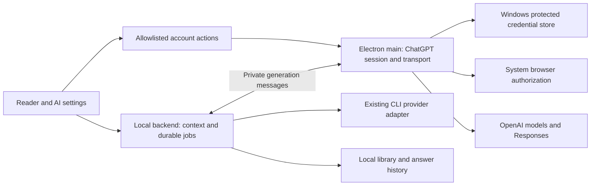

# Windows AI mode: use your ChatGPT plan

Date: 2026-11-04. Status: **implemented as a Windows engineering preview; real account text/visual inference and restart recovery passed**. See [implementation results and remaining release gates](windows-chatgpt-results.md).

Add a direct ChatGPT connection to the Windows desktop app so a reader can install pdfpal, authorize eligible ChatGPT plan usage, and ask about a passage without installing a coding agent. Preserve the existing Claude Code, Codex and OpenCode integrations as selectable alternatives.

This follows the connection already working in pdfpal Android and the owner's `~/src/distillpod` implementation. Windows needs its own account authorization and host identity; it does not import either app's credentials. Product wording should say “Uses your ChatGPT plan” and explain that account eligibility and provider limits apply. OpenAI documents this capability for open-source/local apps through Sign in with ChatGPT. [Official overview](https://developers.openai.com/siwc/token-sharing-open-source)

## Experience and scope

For a new Windows installation, offer **ChatGPT — use your plan** first, with **Continue with ChatGPT** and a secondary choice to use an installed agent. Reading remains available before connecting. Existing installations retain their selected agent and receive an optional entry in AI settings.

The flow is: choose ChatGPT → authorize in the system browser → return to pdfpal → choose an available model → select a passage and ask. Settings distinguish signed out, connecting, signed in without plan permission, ready, expired and limited states. A valid identity without the plan grant remains signed in but cannot send AI requests; offer explicit plan authorization. Settings show the active account/registration, connection state, model, reconnect/disconnect actions and **Manage usage**. Show the first-connection plan-use explanation once and a plan-use indicator near the composer. Do not display invented credit balances or reset times. A connection test that performs inference must be an explicit action. [OpenAI UX guidelines](https://developers.openai.com/siwc/ui-ux-guidelines)

| Surface | Required behavior |
| --- | --- |
| PDF passage and project chat | Direct ChatGPT answers, citations, local history, cancellation and partial-result recovery |
| Visual explanations | Existing structured diagrams, validation and renderer; same selected provider |
| Kindle companion | Paired requests use the desktop's chosen mode; preserve book/client isolation and local OCR |
| Desktop's “Open in browser” | Can read and ask through the running backend; account setup directs the user to desktop AI settings |
| CLI project automation | Creating projects, importing papers, collections and notes continues to work without AI credentials |
| Standalone `pdfpal ask` | Existing CLI providers remain supported; direct ChatGPT outside the desktop host is a separate follow-up |

There is no automatic fallback to API-key billing or another account/provider. Changing a provider is an explicit user action. This change does not bundle Codex, add autonomous research tools, synchronize Android accounts, or implement the separate Windows CLI launcher discussed earlier.

## What the code shows today

| Existing code | Consequence for this change |
| --- | --- |
| `src/core/agents.ts` | `AgentService` discovers binaries, runs subprocesses and owns a global request/shutdown registry. A network provider needs an independent contract and shared lifecycle accounting. |
| `src/core/chat.ts`, `kindle.ts`, `visual-explanations.ts` | Each constructs an `AgentService`; all must accept the same provider dependency. PDF chat persists only after the whole answer returns, while Kindle/visual jobs already have lifecycle records. |
| `src/server/app.ts`, `runtime.ts` | Provider enum, routes, runtime creation and shutdown currently assume agents. Preserve existing callers while adding job/event support. |
| `desktop/src/main.mjs`, `backend.mjs`, `preload.cjs` | Electron owns the window; a utility process hosts the library/backend. Existing RPC validates privileged actions. Extend this boundary rather than putting OAuth in the renderer. |
| `frontend/src/components/AISettings.tsx`, `ChatPanel.tsx`, `frontend/src/desktop.d.ts` | Installation/login cards and provider selection need a direct-account branch, model selection and streaming states. |
| `mobile/android/.../AuthSession.kt`, `SubscriptionProvider.kt`, `ResponseStream.kt`, `ai/AccountRepository.kt` | Working pdfpal reference for authorization, refresh, terminal SSE handling, cancellation, protected pending state and saved answers. |
| `~/src/distillpod/core/.../OAuth.kt`, `app/.../AuthSession.kt`, `SubscriptionProvider.kt`, `TokenVault.kt` and their tests | Reference protocol fixtures and recovery cases. Kotlin/Android storage cannot be transplanted into Electron. |

The references are evidence, not complete Windows specifications. For example, the inspected distillpod `disconnect()` only clears local tokens; pdfpal Android already attempts remote revocation. Both providers use coarse HTTP status handling that the Windows version should improve using the current documented error codes. Preserve attribution when porting code or fixtures.

## Architecture decisions

Introduce an `AIProvider` interface with provider identity/capabilities and generation accepting structured instructions/context, model, cancellation and text-delta callbacks. Keep `AgentService` as the implementation behind an installed-agent adapter. Inject an AI service into chat, Kindle and visual generation; default construction outside Electron remains compatible with the existing CLI.

**Electron main owns the ChatGPT session and network transport.** It opens the browser, handles the temporary callback listener, protects credentials, refreshes sessions, discovers models and consumes Responses streams. The backend requests generation over a bounded private process channel and receives sanitized deltas/results. It owns retrieval and database checkpoints. The renderer receives connection summaries and answer content, never tokens or authorization URLs.

Proposed module boundaries: `src/core/ai/` for provider contracts, context policies and request lifecycle; `src/core/chatgpt/` for testable protocol/parser code without Electron dependencies; `desktop/src/chatgpt/` for the credential vault, session manager, callback listener and private process bridge. Use native HTTP streaming and a maintained JOSE library for token verification; pin the dependency and verify it in the packaged Electron runtime. Port protocol fixtures into TypeScript rather than implementing JWT cryptography manually. Extend staging and packaging deliberately so Node CLI installations do not acquire an Electron dependency.

The main-process broker accepts only generation/model/account operations from its owned backend and trusted main frame. Bound message sizes, concurrent requests and stream buffering; coalesce UI deltas and checkpoint them at controlled intervals. Identify every event by runtime instance and request ID so a restarted backend cannot receive an old result. A lost backend cancels its owned network work. Account management is not added as an unauthenticated localhost HTTP endpoint; retain existing reader origin checks and Kindle pairing authorization.

## Account and credential lifecycle

Use the official public-client flow with a stable opaque host identifier, dynamic initial registration, fresh PKCE/state/nonce and an HTTP callback bound to `127.0.0.1`. Persist the issued client ID; keep the callback path fixed while allowing an available port. Validate callback parameters, ID-token signature/identity and granted plan scope before enabling inference. No client secret is needed. [Registration contract](https://developers.openai.com/siwc/token-sharing-open-source/sign-in)

Store each account/workspace registration separately, including when email addresses match. Reauthorization must retain its client/identity association. Serialize refreshes, atomically save replacement tokens, and preserve usable credentials on temporary network failures. On disconnect, stop that account's requests, attempt documented revocation, clear local tokens, and disclose unconfirmed remote revocation when necessary. Retain the host and registration mapping for later sign-in. [Accounts and sessions](https://developers.openai.com/siwc/token-sharing-open-source/profiles-and-sessions)

Use Electron `safeStorage` with Windows DPAPI in the main process after app readiness, preferably its asynchronous API supported by the pinned Electron build. Keep encrypted records in a dedicated `chatgpt` directory under the desktop profile, separate from `%USERPROFILE%\.pdfpal` documents and exportable library data. Fail closed if protection is unavailable; use atomic replacement and user-restricted filesystem access. DPAPI protects against other Windows users, not every program running as the same user. [Electron safeStorage](https://www.electronjs.org/docs/latest/api/safe-storage/)

Define the host as one desktop profile; give separate profiles independent host IDs and credentials. Hold a profile-level session-owner lock so alternate app instances cannot race refresh-token rotation. Pending sign-in never overwrites a working connection. Cancel/time out the listener cleanly; after a process crash, start a fresh attempt rather than replaying an uncertain code exchange. Test browser preconnections, duplicate callbacks and late callbacks after cancellation.

Before switching accounts, require current work to finish or let the user explicitly cancel it. Bind each submitted request to an immutable account/model/session generation. Revocation, switching or reconnecting must not redirect an in-flight request to another registration. The UI can retain multiple registrations and choose one active account. Never copy mobile, distillpod or installed-agent token files.

## Models, requests and recovery

Fetch the selected account's model catalog with its OAuth bearer. Show display names for visible models in server order; send model slugs. Refresh after account changes and reject stale selections. Send requests to the public Responses endpoint and accept success only at `response.completed`; an HTTP 200 or an ended connection is insufficient. Handle explicit failure/incomplete events and broken streams separately. [Models and inference](https://developers.openai.com/siwc/token-sharing-open-source/models-and-inference)

Build an allowlisted request body: `store: false`, `stream: true`, array input and instructions/developer guidance. Send bounded local conversation context again for each HTTP turn. Omit unsupported controls such as `previous_response_id`, `temperature` and `max_output_tokens`. Use schema-validated text to generate the existing SVG diagrams. Provider image generation and hosted file-search tools are not part of this integration. [Preview limitations](https://developers.openai.com/siwc/token-sharing-open-source/preview-limitations)

Preserve retrieval and passage citations, but separate trusted instructions from document evidence in all three services. Apply a total context budget across excerpts, user question and history; use model limits when supplied and a tested conservative bound otherwise. Surface insufficient context rather than pretending to have read the entire paper. `store: false` does not imply no provider-side operational retention.

Introduce an additive durable AI-job record containing request ID, reading scope, mode, provider, opaque account reference, model, question/context references, partial text, status and timestamps. Never store authentication tokens in it. Existing successful chat rows and saved visuals remain readable. New jobs transition through pending/running to complete, failed, cancelled or interrupted. Checkpoint partial answers; commit a final chat turn exactly once only after terminal success. Reuse existing Kindle/visual lifecycle tables where appropriate and add the missing PDF/project-chat lifecycle. Mark stale jobs interrupted on restart and offer an explicit retry without automatic resubmission.

Keep legacy synchronous chat routes working through an adapter; add job start/status/cancel and authenticated/same-origin event transport for the desktop reader. Reconnect to a saved job after renderer reload without resending inference. A disconnected view does not itself cancel a job, but Stop, account disconnect, backend death and application quit do. Integrate network jobs into the existing active-work quit dialog and drain logic alongside CLI subprocesses.

Classify errors by status and structured code: usage limits offer Manage usage; ineligibility/policy restrictions explain the restriction; temporary unavailability preserves credentials; terminal refresh failures require reconnect. A 403 must not automatically become an OAuth loop. Retry safe metadata reads with bounded backoff; do not automatically retry inference after uncertain delivery or a partial stream. Retain sanitized diagnostic codes/request IDs, excluding raw headers, tokens, callback URLs and document bodies. [Errors and recovery](https://developers.openai.com/siwc/token-sharing-open-source/errors-and-recovery)

## Configuration and compatibility

Add `ai_mode: "chatgpt" | "agent"` without widening `AgentName` to treat ChatGPT as an executable. Retain `agent`, executable paths and legacy `model`; add a separate direct-mode model preference keyed by opaque registration. Account credentials stay out of `config.json`.

Existing configuration maps to agent mode. Document precedence for explicit startup overrides, new mode settings and legacy `PDFPAL_AGENT`; an explicit per-request agent must never be silently replaced by ChatGPT. New desktop profiles offer ChatGPT first but enable it only after successful authorization. Persist explicit choices atomically and preserve unrelated configuration.

Inject the direct provider only into the desktop-owned runtime. If a standalone CLI AI command resolves to direct mode without that host, return an actionable unsupported-runtime error before inference; `--agent` still explicitly selects an installed provider. Project/source/collection/note commands continue independently. Do not read DPAPI credentials from WSL or create a second owner of the Windows session. If an existing CLI server owns the library, preserve the current recovery flow rather than taking ownership silently.

Upgrades retain library data and valid desktop sessions. An older app cannot understand new durable-job schema changes: preserve automatic pre-migration backups and the newer-schema guard, and test/report rollback behavior. Never advise opening the live library with an incompatible old binary. Document whether retained desktop-profile credentials survive uninstall and provide Disconnect before uninstall; library backups exclude credentials.

## Implementation sequence — TDD for every task

| Task | Write failing tests first | Deliverable / exit gate |
| --- | --- | --- |
| 1. Provider contract and configuration | Legacy config, explicit overrides, adapter parity, unsupported headless direct mode | Existing CLI/provider flows remain green; services accept an injected provider |
| 2. Windows sign-in and vault | PKCE/callback rejection, identity/scope validation, encryption failure, atomic writes, competing profile owners | Packaged app completes its own sign-in and restores a protected session after restart |
| 3. Accounts and model catalog | Same-email registrations, refresh races, account switching, revocation, stale model choice | Settings selects an eligible account/model and distinguishes identity-only authorization |
| 4. Direct inference transport | Split UTF-8/SSE frames, terminal errors, incomplete streams, request-field allowlist, cancellation, output bounds | Explicit live text request completes without an agent executable; no uncertain automatic retries |
| 5. Durable jobs and reader streaming | Migration fixtures, partial checkpoints, duplicate completion, reload/kill recovery, context budgets | Passage/project answers stream and survive interruption; no duplicate saved turn or resend |
| 6. Visual and Kindle parity | Invalid visual JSON/references, per-book/client scope, request/provider binding | Both real-paper visual and paired Kindle questions work through the same selected mode |
| 7. Onboarding and lifecycle | Fresh versus existing user, missing agents, declined permission, keyboard/accessibility, tray quit with active work | Complete reader flow without terminal setup; existing CLI cards and workflows still work |
| 8. Windows acceptance and packaging | Install/upgrade/profile migration, dependency staging, secret-free diagnostics, no system Node/agent dependency | Testable Windows installer, checksums, release notes and evidence report |

Tasks 1–4 establish the Windows auth/inference path before the broader UI rollout. Tasks 5–7 complete product integration. Task 8 is the release gate. Current scope is planning only; no release or live account action is performed by this document.

## Acceptance scenarios

1. A Windows account with no Node, Codex or Claude Code installed can import a PDF, authorize ChatGPT, ask about a difficult passage, receive a completed answer and reopen it after restart. Use a real browser and packaged app; mocks alone cannot pass this gate.
2. Use separate passages from *Attention Is All You Need*: explain shifted decoder inputs despite causal masking, then visually explain square-root scaling in attention. Record actual outputs and citations; neither demo is a paper summary.
3. Test the installed reader, its browser view and the paired Kindle companion. Kindle's current selection/book scope must not inherit unrelated PDF or account context.
4. Disconnect networking mid-stream, cancel, reload the renderer, crash the backend and quit from the tray. Keep partial work accurate and confirm zero automatic new inference requests.
5. Exercise declined plan permission, wrong state/nonce/client/identity, expired credentials, revoked access, usage limits and account/workspace policy failures. Inspect diagnostic exports and browser storage for credential leakage.
6. Switch between two registrations with the same email in fixtures, and validate an available second registration live when possible. Refresh and revoke one without mutating the other; historical answers remain readable after disconnect.
7. Upgrade an existing library with saved PDF/Kindle chats and visuals. Verify record preservation, default-provider preservation and CLI project automation. Run core, CLI, reader, extension and native Windows lifecycle suites affected by the provider refactor.

Write results to `docs/windows-chatgpt-results.md` during implementation, separating automated tests, real-account evidence and any untested fresh-machine conditions. A real sign-in is user-interactive; the final live gate needs the user's browser authorization just as Android did. The implementation can proceed through mock-backed tests and packaging before that interaction.
