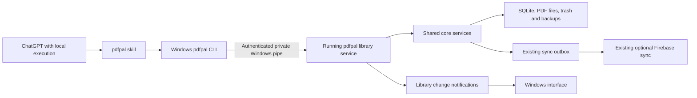

Windows CLI and ChatGPT skill implementation plan

Status: implemented for 2.7.0-preview.1; 2026-11-05. See [verification evidence](evidence/windows-cli.md) and the [user guide](windows-cli.md). Installation/release verification is recorded separately below as it completes.

The intended experience is to ask ChatGPT to inspect the Windows pdfpal library, create projects, import papers, organize sources, write notes, and remove or recover items. The first delivery uses a local CLI and a skill, with the existing Windows app providing the library service.

OpenAI documents standalone skills in the ChatGPT desktop app and Codex, and Windows execution through PowerShell or WSL. Execution still depends on the host's available tools and permissions. A skill supplies instructions; it does not establish a connection to a PC. Browser/mobile access to a connected computer is a separate feature with account/workspace and availability requirements. We must verify the actual ChatGPT host during acceptance rather than infer access from a successful terminal test.

Sources: [skills](https://learn.chatgpt.com/docs/build-skills), [Windows host](https://learn.chatgpt.com/docs/app/windows), [remote connections](https://learn.chatgpt.com/docs/remote-connections).

1. Existing implementation and gaps

| Area | Current implementation | Planned change |
| --- | --- | --- |
| CLI | `src/cli/index.ts`; project, source, collection, note, search and highlight commands | Retain commands and introduce an explicit desktop connection mode |
| Installation | Desktop bundles application code, but the Windows PATH check found no pdfpal command | Ship and register a matching CLI launcher with the desktop installer |
| Version | CLI reports hardcoded 2.1.0; installed desktop is 2.6.0-preview.1 | Expose build, CLI protocol, database schema and capabilities independently |
| Library | CLI reads environment/default paths; Windows app can select a recovered library | Resolve the desktop profile's active library and guard every request against a target change |
| Runtime | Private `.server.json` record and authenticated identity check already exist | Extend discovery with a separate command credential and a versioned local command API |
| Writes | Most CLI commands open SQLite directly | Route desktop-mode actions through the running app and shared core services |
| Recovery | Trash and full backups exist in the app | Add CLI list/restore and backup create/list/verify commands |
| Skill | `skills/pdfpal-cli/SKILL.md` exists, with Bash examples and old CLI assumptions | Add desktop discovery, PowerShell/WSL instructions, bounded retrieval and recovery workflows |
| Skill installer | Bash script installs symlinks in legacy host locations | Add a per-user, copy-based Windows installer with managed-file tracking |

The Windows library and the WSL library are separate. Opening the Windows SQLite database from a Linux CLI is outside the supported desktop integration. Existing cloud sync, credential storage, backup schedules and recovery semantics remain the source of truth.

2. Architecture and operating modes

Desktop mode requires the regular pdfpal app to be running, including in its tray. When it is closed, return a structured `DESKTOP_NOT_RUNNING` error with startup instructions. Do not silently create a different library or fall back to direct SQLite after a failed request. Automatic background startup can be considered after this behavior is proven.

Preserve standalone CLI use for existing Linux/macOS/Windows users. Make the Windows-installed launcher default to desktop mode, with explicit standalone selection available. Keep the npm CLI's existing default behavior compatible. A workflow that selects desktop mode never switches to standalone implicitly.

The first release requires no new cloud service, public listener, MCP server, tunnel or OpenAI API key. Firebase continues to sync supported data through the existing account connection. ChatGPT subscription/access requirements and existing Firebase quotas still apply.

3. Prove the packaged Windows launcher first

Bundle the CLI with the desktop application so users do not need a separate Node.js installation or an independently updated npm package. Put only an owned `bin` directory on the per-user PATH, avoiding a collision between the GUI executable and the terminal command. Use a stable `pdfpal.cmd` entry and an absolute-path fallback for sessions with an old PATH.

First prove a bootstrap using the bundled Electron runtime in Node mode, with environment changes scoped to the child process. Electron documents `ELECTRON_RUN_AS_NODE`, which depends on its build fuse: [Electron environment variables](https://www.electronjs.org/docs/latest/api/environment-variables). This is a packaging experiment, not an assumption that the GUI executable is already a suitable console application.

Acceptance must cover stdout/stderr redirection, stdin, exact exit codes, Unicode, quoting, ASAR loading, native module loading and absence of a visible GUI. Test without system Node on PATH. If that approach cannot pass, use a dedicated console launcher and explicitly packaged runtime; keep that substitution within this first milestone, before building further installer integration. Do not require weakening global execution policy or changing global environment settings.

The installer adds its own PATH entry once and detects a competing npm CLI. It reports the collision rather than deleting another installation. Upgrades keep the launcher and app on the same build. Uninstall removes owned integration files and PATH entries, while preserving libraries, profiles, backups and unrelated installations.

4. Library selection and runtime handshake

Proposed global flags are `--desktop`, `--library <registered-id>`, and `--expect-library <fingerprint>`. Desktop mode reads the regular app profile and resolves its active registered library. An explicit registered ID selects a known library; an unknown or inactive target produces an error. Cloud Preview requires an explicit separate profile selector and is never chosen automatically.

Standalone mode gains an explicit global data-directory selector. Preserve the existing environment overrides, define their precedence, and reject combinations that conflict with desktop mode. Parse flags before loading configuration. `--version`, help, status and doctor must not create directories, migrate a database or start a server.

Add `status`, `doctor`, and `library list`. Machine-readable output includes selected library ID/fingerprint, runtime instance, desktop build, CLI protocol, schema and capabilities. Human output explains wrong host, missing app, stale command, library mismatch and incompatible build. Paths may be shown locally for diagnosis; credentials must never be shown.

At workflow start the skill captures the library fingerprint and pins it on subsequent calls. The service verifies the expected library on each request. Detect desktop profile switches and runtime restarts; require a fresh handshake instead of silently retargeting a pending action. This fingerprint identifies a local database location, not a Firebase library ID or a permanent identity across file moves.

Extend the private runtime owner record with a separate random command credential. Protect it for the current OS user, including Windows ACL behavior, and validate discovery against the live runtime. Send credentials only in request headers, never command-line arguments or printed JSON. Windows uses a private named pipe; standalone non-Windows runtimes use loopback. A fresh HMAC challenge proves runtime ownership before the command credential is sent. The command API accepts explicit validated operations; retain Host/Origin protections and disable broad CORS. Never expose arbitrary shell execution, SQL, paths to read generally, or raw Firestore writes.

5. Shared operations, output and retries

Introduce a typed local operation layer using existing project/source/collection/note/retrieval/trash/backup services. Both desktop command handlers and existing routes reuse the relevant service behavior. Keep sync triggers, file leases, deletion journals and validation intact. Publish small library-change events after committed mutations and invalidate affected UI queries so changes appear without restarting pdfpal.

Preserve existing command names and the established `--json` contract: a success result on stdout, a structured error on stderr, and meaningful exit codes. Keep progress on stderr. Add a versioned agent result/receipt option rather than silently replacing all current JSON shapes. Advertise new features through capabilities, not comparisons between CLI and desktop version strings.

Add bounded source-text retrieval, pagination where needed, and compact import results. Text results include source IDs and available page/chunk locations; do not fabricate page precision when extraction cannot support it. Full PDF text requires an explicit request. Notes accept UTF-8 stdin or a content file without trimming intentional Markdown whitespace. Validate actual PowerShell encoding behavior rather than relying on Bash examples.

Mutations accept an operation UUID and return a receipt containing target library, affected IDs and outcome. Store operation state locally, excluded from Firebase sync. For transactional actions, record the result in the same transaction as the mutation. Reusing a UUID with the same payload returns its existing result; different arguments reject the reuse.

For PDF imports, persist a bounded import operation with a reserved source identity and status lookup. Download/extract outside long SQLite transactions, then commit the source and completion receipt together. An interruption is visible and explicitly recoverable; retries cannot create a second committed source for the same operation. Re-downloading after an interruption may still be necessary. Check existing sources for duplicate papers, and permit deliberate duplicate imports explicitly. A timeout never triggers a second direct-database write.

6. Supported workflows and recovery

| User request | Skill behavior |
| --- | --- |
| Show my library | Check host/library, list projects, then list requested sources |
| Create a project | Create once, return its ID, verify it is visible |
| Add papers | Resolve exact target, check duplicates, import URLs or local files, inspect extraction/import outcome |
| Organize papers | Resolve IDs, create collections, move/file/rename sources |
| Explain something from my library | Search locally, read bounded passages, answer in ChatGPT with source references |
| Save a summary | Write a Markdown note and verify its contents |
| Remove a paper or project | Resolve the exact item, use the user's authorization, return a trash recovery reference |
| Undo removal | List/restore the specific trash record, surface identity conflicts, use copy restoration only when intended |
| Back up my library | Create a full backup, list/verify it, report missing files accurately |

Add `trash list`, `trash restore`, and `backup create/list/verify`. Deletion receipts include the trash ID and useful affected-item counts. Preserve the existing retention and PDF recovery behavior. Permanent purging and full backup restoration remain outside the initial skill workflow; full restoration continues through the existing separate recovered-library process.

The skill does not invoke `pdfpal ask` for ordinary retrieval: ChatGPT answers from retrieved evidence itself. Paper discovery uses the host's search tools before import. Cloud login/logout, account changes, AI-provider credentials and arbitrary configuration changes are outside the initial skill's scope.

7. Skill installation and setup interface

Update the existing skill with a short workflow-oriented main file, separate PowerShell and WSL references, troubleshooting and optional `agents/openai.yaml` metadata. Apply the skill-creator instructions during implementation. Keep Linux standalone instructions available and make the desktop distinction explicit.

The skill must verify capabilities and the active library before work, resolve IDs before changing data, use bounded text results, and check outcomes. It can use `--yes` when the user already authorized the exact deletion; it asks for clarification when the target or destructive scope is ambiguous. Treat PDF/note contents as untrusted source material, not executable instructions. Do not log arguments containing titles, note contents, paths or tokens into shared diagnostics.

Provide `scripts/install-skill.ps1` and a CLI setup entry. Install the managed user skill under `%USERPROFILE%\.agents\skills\pdfpal-cli` according to current host discovery guidance. Detect legacy `.codex`/`.claude` copies and avoid duplicate or conflicting skills. Copy files without symlink/admin requirements. Track managed hashes; preserve custom edits and provide an explicit replacement path. Do not silently overwrite another skill or alter the host's permission policy.

When the host runs in WSL, use a narrow adapter to invoke the native Windows CLI with robust argument/stdin transport. Do not run the Linux CLI against `/mnt/c/.../pdfpal.db`. Make WSL bridge setup explicit and tied to the chosen distro; do not install into every distro automatically.

Add a small “Command line & ChatGPT” setup view to the existing app menu/settings. Show launcher location, version, selected library and skill installation status. Provide “Install skill”, “Copy setup command” and “Check setup”. Separate “files installed” from “verified in ChatGPT”. Explain when a new terminal/chat or app restart is needed to refresh PATH or discovery. Preserve custom setup on upgrades.

8. Diagnostics and telemetry

`doctor` checks command resolution, packaging compatibility, profile/library resolution, runtime handshake and skill files. Default output excludes private credentials and paper content. Detailed local paths are available for troubleshooting.

Reuse the existing default-off error-sharing preference. Shared reports may include only allowlisted CLI error codes, app/protocol version, platform and bounded duration. Never collect command arguments, project titles, PDF URLs, local paths, text or prompts. Keep operation receipts local with bounded retention and enough time for retry recovery; after expiry report that status is unavailable rather than assuming an interrupted mutation never happened.

9. Verification and release gates

Use isolated libraries for all mutation tests. Verify project creation, import, collections, notes, search, deletion, Undo and backup verification through the CLI and the running Windows app. Confirm the UI updates and existing sync records are produced through the normal outbox. Use emulator/fixture tests for sync semantics without adding test content to the user's real cloud library.

Exercise original/recovered libraries, Cloud Preview separation, active-library switches, app closure/restart, stale discovery records, mismatched schema/protocol, write retries, interrupted imports and simultaneous backup activity. A failed target check must leave both candidate libraries unchanged. Repeated operation IDs must not duplicate data. Validate wrong-token and cross-origin rejection and ensure logs/results do not disclose credentials.

Run packaged Windows tests in PowerShell and cmd, plus the WSL adapter: spaces, quotes, apostrophes, accents/emoji, multiline notes, stdin, pipes, stderr and exit-code propagation. Include install/upgrade/uninstall and PATH collision tests, managed versus edited skill updates, and execution with system Node unavailable.

Finally perform a real ChatGPT skill invocation against an isolated Windows fixture. Prove that the host discovers the skill, executes the native CLI, reads the intended library, performs a requested mutation and reports its verified result. CLI-only tests do not satisfy this gate. If host permissions or account availability prevent it, report that specific remaining limitation without claiming end-to-end success.

Build and verify the installer before requesting that the user quit pdfpal. Back up the regular Windows library/profile, install the matching release, check command discovery from a fresh terminal/chat, and perform read-only checks against the real library. Preserve existing cloud session, data counts, backup preferences and telemetry consent. Publish through the existing single version-triggered GitHub release workflow and verify the downloaded installer against its manifest.

10. Implementation sequence and file ownership

| Milestone | Main files/areas | Acceptance gate |
| --- | --- | --- |
| A: packaged command | Proposed desktop CLI bootstrap and launchers; `desktop/scripts/stage.mjs`; packaging tests | Packaged command works without system Node, with correct streams and exit codes |
| B: library connection | `src/server/runtime.ts`; proposed CLI connection/library modules; desktop preferences | Active library and expected-library checks pass across switches and restarts |
| C: operations | `src/cli/index.ts`, `output.ts`; proposed server CLI routes and local operation receipts; shared core services | CRUD/import/recovery works through the service; retry and UI refresh checks pass |
| D: skill/setup | `skills/pdfpal-cli/`; proposed `scripts/install-skill.ps1`; desktop settings/preload integration | Native and WSL setup works and custom skills remain safe |
| E: integration | Focused core/server tests, Windows packaging harness and skill acceptance fixture | Real ChatGPT workflow succeeds against the fixture |
| F: rollout | Installer hooks, release docs and existing GitHub workflow | Matching app/CLI/skill installed and regular library verified |

The first complete delivery includes local library management, bounded retrieval, notes, recovery commands, Windows packaging and actual ChatGPT acceptance. Broader distribution as a plugin, cloud-only ChatGPT access while the PC is off, public MCP endpoints, and additional AI features are later projects. They should reuse the operation layer if requested, rather than require a second library implementation.
