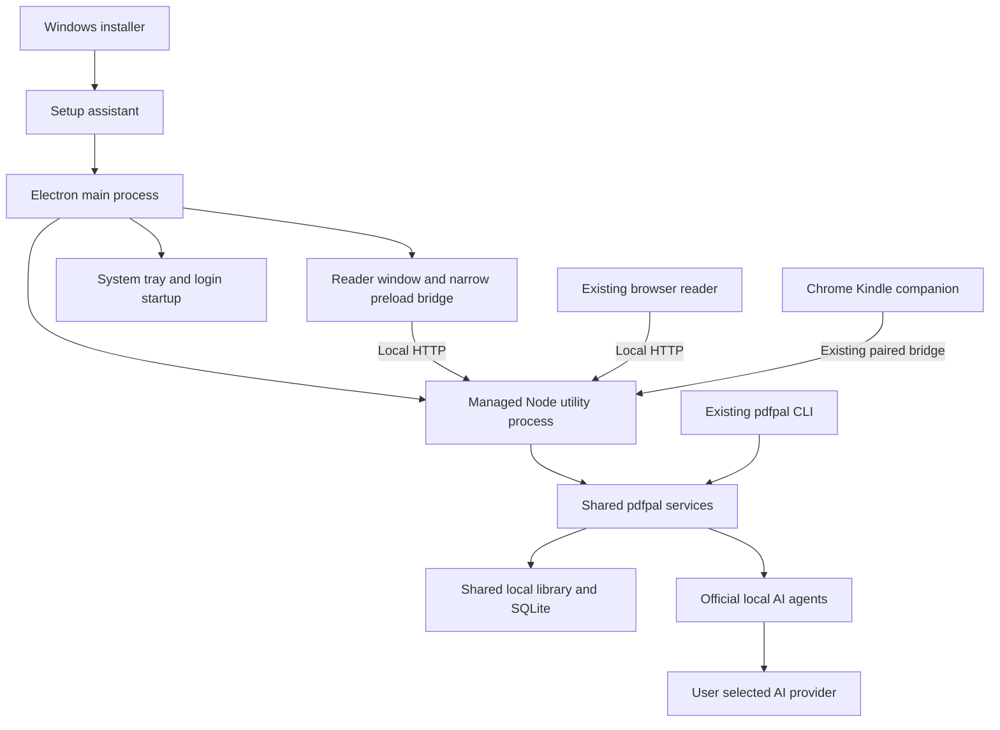

# Windows desktop application proposal and implementation plan

Status: proposed implementation plan. No desktop functionality is implemented by this document.

Implementation update: M0's packaged Windows runtime and Codex live-account proof are implemented. Claude's live-account gate awaits renewed native Windows authentication. See [M0 results](windows-m0-results.md) for evidence and remaining limits; subsequent milestones remain pending.

Date: 2026-10-29.

## Proposal

Release an optional Windows desktop edition of pdfpal that a person can install, open, and use without maintaining a terminal session or installing Node.js for pdfpal. Reuse the existing reader, local backend, and library. Keep the npm CLI and browser interface supported.

The desktop application runs in its own window and remains available in the Windows system tray when that window closes. It uses the user's locally installed, authenticated AI agent. The initial guided integrations are Claude Code and Codex, using their supported subscription authentication. Existing OpenCode support remains available through the existing configuration; a guided OpenCode account setup is outside the first release.

The installer starts a setup assistant that detects agents, distinguishes installation from authentication, helps resolve missing dependencies or sign-in, and gets the user to their first PDF question. The installer and setup assistant should feel like one continuous experience. Detection must also remain available in Settings after installation.

Use Electron with TypeScript and electron-builder for distribution. Electron embeds Chromium and Node.js and supports Windows, macOS, and Linux from the same application codebase. This suits the existing React and Node.js implementation. Windows is the only initially supported desktop platform; packaging and platform adapters should allow later ports without rewriting the product. See the [Electron introduction](https://www.electronjs.org/docs/latest/).

The public promise is: **Read difficult material with an assistant beside you, using your existing AI account.** Explain that the library is stored locally and that relevant reading context is sent through the chosen agent to its provider. Local account reuse does not mean offline AI or unlimited usage.

## Goals and scope

### Goals

- Make the PDF reading workflow accessible without terminal commands for a user with a supported agent already installed and signed in.
- Provide a guided path for someone with an eligible AI account but no agent installation.
- Keep pdfpal available to the Kindle companion while the reader window is closed.
- Preserve projects, PDFs, notes, highlights, conversations, visual explanations, and CLI workflows.
- Detect and explain installation, authentication, configuration, and connectivity problems separately.
- Establish repeatable Windows builds, installation tests, upgrade tests, and support diagnostics.
- Keep operating-system-specific code small and isolated for future macOS and Linux releases.

### First release boundaries

| Area | Included | Deferred |
| --- | --- | --- |
| Desktop platform | Windows 11 x64, normal user account | Windows ARM64, Windows 10 support claims, macOS and Linux installers |
| Distribution | Per-user installer, Start menu entry, optional desktop shortcut, uninstall, signed public release | Microsoft Store, enterprise deployment, no-install portable ZIP |
| Reader | Existing PDF, project, notes, highlights, chat, and visual features | Reader redesign, new document formats |
| AI | Guided Claude Code and Codex detection, native Windows execution, official sign-in, connection test | Hosted AI, pdfpal billing, bundled models, custom provider login, guaranteed usage quota reporting |
| Background behavior | System tray, optional start at login, explicit quit, crash recovery | Windows service, multiple simultaneously managed libraries |
| CLI | Existing npm distribution, commands, shared data and compatible configuration | Bundled standalone CLI executable and automatic PATH registration |
| Kindle | Existing Chrome companion and local pairing, bundled extension download | Native Kindle application integration, Chrome Web Store publication |
| Updates | Check for updates, official release download, signed installer upgrade preserving data | Automatic background download and installation |

The Windows baseline is a proposed support commitment, not a statement that other systems cannot run the code. Confirm the selected Electron release and provider versions against the baseline before implementation is locked.

## Current implementation and required changes

| Current evidence | Implication |
| --- | --- |
| `src/core/` implements shared services used by the CLI and server. | Add a desktop entry point; keep domain logic shared. |
| `buildServer()` returns a Fastify instance; `startServer()` starts it and optionally opens a browser. | Extract a reusable start/stop lifecycle with explicit ownership and readiness. |
| Server shutdown already closes Kindle jobs, visual jobs, and SQLite through an `onClose` hook. | Extend this lifecycle to all active agent requests and desktop shutdown. |
| Agent discovery checks `where` on Windows or file existence for an absolute path. | Replace availability-only checks with resolved executable, version, auth, and invocation diagnostics. |
| Agent invocation uses `spawn`, and tests use POSIX shell scripts. | Implement and test Windows execution, including legacy npm launchers, without relying on shell-string interpolation. |
| The frontend stores its selected agent in browser local storage. | Define how setup defaults and existing per-interface selections interact; do not overwrite a valid existing selection. |
| `~/.pdfpal` holds configuration, SQLite, managed PDFs, and migration backups. | Keep this default for desktop and CLI; do not silently create a second library in Electron's application-data folder. |
| SQLite uses WAL and a five-second busy timeout, with backups before migrations. | Preserve normal CLI concurrency and add explicit protection around simultaneous startup, migration, and incompatible versions. |
| Frontend and extension assets are resolved relative to server modules. | Add an explicit packaged-resource resolver and test it outside the checkout. |
| `/api/health` returns only an OK status. | It cannot establish server identity, library ownership, or compatibility. Do not use it alone to adopt a running server. |
| Existing CI runs on Ubuntu. | Add Windows coverage and actual packaged-application checks. |

## User experience

### Installation and setup

1. The user downloads a Windows installer from the official release page. The page describes the AI-account requirement before download.
2. The installer installs pdfpal for the current user, without requiring a separate Node.js installation. Application files and library data have different locations.
3. Setup launches pdfpal under the interactive user's account. Agent detection runs here, outside any elevated installer process. This avoids inspecting an administrator's PATH or authentication instead of the reader's account.
4. Setup presents detected assistants with a plain-language state and one useful next action. A single usable assistant can be preselected; multiple usable assistants require a choice. Preserve an existing explicit preference.
5. The user can connect an installed agent, install a missing supported agent, choose an executable under advanced options, or continue without AI.
6. An optional **Test connection** action submits a short fixed prompt through the selected agent. Explain that it uses the provider's allowance. Do not send document contents or launch generation during passive detection.
7. The user opens a PDF, creates or chooses a project, and asks a question about a selected passage. Use existing source management; avoid creating a second document model for desktop.
8. Setup completion is persisted. **AI settings** can repeat detection or sign-in later.

If setup is cancelled, offline, or interrupted, installation still succeeds and the next launch resumes the relevant step. PDFs, notes, and organization remain usable without an AI connection. A user who installed an agent while pdfpal was open can click **Check again** without rebooting Windows.

Discovery refresh must account for updated Windows user and machine PATH values, rather than repeatedly using the desktop process's original environment. Do not search the current document directory for executables unless the user explicitly selected that path.

### Setup states

| State | Meaning | Primary action |
| --- | --- | --- |
| Checking | Detection is still running | Continue without AI remains available |
| Not installed | No supported executable was found | Install assistant |
| Installation needs attention | A candidate exists but fails version/runtime checks | Repair guidance or choose executable |
| Update needed | Installed version lacks a required capability | Open supported update flow |
| Sign-in needed | Supported auth check reports no active login | Sign in through the agent |
| Signed in with account | Agent reports account authentication | Use this assistant or test connection |
| API or external-provider credentials | Agent reports usage-based or external configuration | Explain billing mode before selection |
| Status unavailable | Version does not expose enough information, check timed out, or output was unrecognized | Retry or test connection; do not label it signed out |
| Connection verified | A user-requested test returned a valid answer | Start reading |
| Provider temporarily unavailable | Live request failed due to connectivity, limits, or service error | Retry or select another configured assistant |

Show the time of the last successful connection test. Authentication detection alone must not produce a claim that the subscription has remaining usage, that a particular paid tier is active, or that all selected models are available.

### Window and tray

- Launching from the Start menu opens the reader. Launching a second time restores and focuses the existing desktop instance.
- Closing the window hides it and keeps the local backend running. Explain this once with an accessible message and a visible Quit action.
- Tray menu: **Open pdfpal**, **Open in browser**, **AI settings**, **Start with Windows**, **Check for updates**, **Quit**.
- **Start with Windows** is off by default. When enabled, login launches into the tray. If setup is incomplete or startup fails, show an actionable notification and keep recovery available from the tray.
- Closing the window does not cancel a running answer. Reopening restores the relevant view and displays the completed answer or current state.
- Explicit Quit stops the backend owned by the desktop application. If work is active, offer **Keep running** or **Quit and cancel requests**. Windows shutdown must use bounded cleanup without waiting indefinitely for a prompt.
- If tray creation fails, keep a reachable window and a normal Quit action. Never leave an invisible application that the user cannot recover.
- Persist window bounds, maximized state, and the last useful route. Clamp restored bounds to available monitors, including after dock or display changes.

### Recovery and diagnostics

Display specific recovery messages for missing agents, expired sign-in, provider limits, occupied ports, unavailable data folders, incompatible database versions, and missing packaged assets. Avoid exposing raw stack traces as the primary user message.

Keep bounded local logs and offer **Export diagnostics** with a preview of included fields. Include app/provider versions, platform, failure codes, and timing. Exclude credentials, authentication output beyond allowlisted fields, document text, prompts, generated answers, and full personal file paths. No automatic telemetry or crash upload is required for the beta.

## AI integration design

### Shared provider adapter

Introduce a provider adapter boundary used by the desktop, server, and CLI. Keep discovery and authentication checking separate from answer generation.

The contract should support `discover`, `probeVersion`, `probeAuth`, `beginLogin`, `testConnection`, `invoke`, and cancellation where the provider permits it. Installation assistance belongs to a separate platform-specific setup service. Return typed outcomes rather than treating every nonzero exit as a missing agent.

Normalized diagnostics should include provider ID, discovered installation kind, executable path for local internal use, version, installation state, authentication state, authentication mode, observation timestamp, and a safe error code. Raw tokens, credential files, and unfiltered command output never enter frontend state or diagnostics exports.

Retain existing CLI configuration precedence: command overrides, environment, configuration file, defaults. Persist user-selected provider and executable overrides atomically without losing unrelated keys. Desktop-only preferences belong in a separate file. Explain when an environment override supersedes a saved setting.

### Claude Code detection

Use this ordered discovery process:

1. Respect an explicitly configured executable. Report a broken explicit choice rather than silently switching to another account or install.
2. Enumerate relevant executable candidates from the user's PATH. Do not accept just the exit status of `where` or blindly choose the first result.
3. Check the documented native installation at `%USERPROFILE%\.local\bin\claude.exe` even if that directory is absent from the desktop process's PATH.
4. Resolve supported WinGet and legacy npm installations through their actual launchers and installation metadata. Treat guessed locations as candidates only. Provide **Choose executable** for nonstandard installations.
5. Reject known Claude Desktop application aliases and validate remaining candidates with a bounded `--version` invocation. The executable must identify itself as Claude Code. Record the exact resolved path so invocation uses the same installation that was checked.
6. Run `claude auth status` through that executable, parse its JSON defensively, and distinguish account authentication, API configuration, external provider configuration, and unavailable status. Older versions with unsupported commands receive an update or unknown-state result.
7. Offer the official `claude auth login` flow when needed. The agent owns browser authentication and credential storage. Recheck status after login completes or is cancelled.

Anthropic documents the native location, binary verification, and the Windows conflict where Claude Desktop can override the `claude` command in its [installation troubleshooting](https://code.claude.com/docs/en/troubleshoot-install). Its [CLI reference](https://code.claude.com/docs/en/cli-reference) documents the JSON authentication command and authentication modes. These are discovery and diagnostic capabilities, not guarantees of available subscription allowance.

Do not use the presence of `.claude`, Claude Desktop, a browser login, or a registry display name as proof that pdfpal can invoke Claude Code. A WSL installation is a separate environment; the initial Windows edition guides users to a native installation instead of automatically traversing WSL distributions or copying credentials.

### Codex detection

Apply the same explicit-path, candidate-validation, version, and auth-state separation to Codex. Validate native Windows and npm installation paths during the initial compatibility spike; do not assume a Unix layout or that a desktop app installation exposes a callable CLI.

Use `codex login status` to inspect the authentication mode and the official login flow when needed. Codex documents ChatGPT sign-in for subscription access and API-key sign-in for usage-based access in its [authentication documentation](https://learn.chatgpt.com/docs/auth). Preserve unknown status when a supported command cannot establish the needed information.

Test the existing `codex exec` flags and native Windows sandbox setup on a clean machine. A successful version or login check is insufficient if noninteractive invocation still requires additional runtime setup. Do not solve compatibility failures by silently disabling sandbox or approval restrictions.

### Subscription behavior and provider conditions

Invoke each provider's official CLI as the signed-in user. Do not extract session tokens, reproduce a provider's private API, or implement a pdfpal-owned subscription login. Do not switch providers, models, accounts, or API billing modes without a user choice.

Before public distribution, confirm the exact integration and installation flow against each provider's current published conditions. Anthropic explicitly documents conditions for running its unmodified CLI in another product, direct end-user authentication, and restrictions on credential intermediation in its [integration conditions](https://code.claude.com/docs/en/legal-and-compliance). This plan relies on the supported local-CLI approach; technical detection alone does not settle every distribution condition.

Keep provider capabilities versioned and maintain a tested minimum version per provider. Changes in authentication output or provider terms should affect an adapter and its setup copy, not require changes throughout the reader.

### Missing agent installation

Setup should offer a user-initiated installation action for each promoted provider. The first compatibility milestone must determine and test the official native Windows installation mechanism, dependencies, integrity verification, cancellation, and any elevation requirement.

Prefer a supported native installation or exact package-manager identity over npm setup for nontechnical users. Installing pdfpal's embedded runtime does not automatically satisfy an external npm launcher's Node.js requirement. Do not ship a button claiming one-click setup until the complete provider path works on a clean account without developer tools.

If an installation mechanism needs an external window or additional consent, explain it in place and resume detection afterwards. Never execute a command copied from arbitrary remote content or accept arbitrary shell arguments from the renderer. Do not upgrade or replace an existing provider installation automatically.

### Process execution and cancellation

Use structured process arguments and stdin for prompts where supported. Handle paths with spaces, Unicode, quoted arguments, and Windows launcher formats deliberately. A blanket `shell: true` is not an acceptable fix for `.cmd` support. Resolve a supported underlying executable or use a narrowly defined launcher adapter with tested Windows quoting. See Node's [Windows process guidance](https://nodejs.org/api/child_process.html#spawning-bat-and-cmd-files-on-windows).

Use asynchronous probes with bounded timeouts, capped output, cached results, and an explicit refresh. Initial target: each passive probe finishes or times out within five seconds, with the UI responsive throughout. Hide console windows for background probes and inference; show the provider's interactive flow only when required for sign-in or installation.

Track processes owned by each request. Cancellation, timeout, parent exit, and Windows shutdown must clean up owned descendants without killing unrelated provider sessions. Never search by executable name and terminate all matches. Verify a Windows process-tree ownership strategy in the spike, including abrupt desktop termination.

Treat PDF content and provider output as untrusted. Audit tool access for the reading invocation: prompts alone do not enforce filesystem or shell restrictions. Preserve existing supported research behavior deliberately and verify documented provider controls before changing defaults. Do not grant broad machine access merely to make a packaged demo pass.

## Desktop architecture



### Process and package boundaries

Add a `desktop/` workspace containing the main process, preload, lifecycle management, setup orchestration, platform adapters, packaging configuration, and desktop tests. Keep reusable provider detection, configuration, and service lifecycle in the shared source tree.

Run Fastify and the core services in a managed Electron utility process so database work, PDF extraction, and provider checks do not block the tray or window controls. Electron's [utility process API](https://www.electronjs.org/docs/latest/api/utility-process) supplies a Node-enabled child and message channels. Validate ESM loading, PDF workers, process spawning, and native SQLite in a packaged spike before treating this boundary as settled.

The managed backend reports readiness and its exact bound origin over a private process channel. Display the reader only after readiness. Do not render an arbitrary service that happens to occupy the configured port. Keep setup and startup-error UI available when the backend cannot start.

If the backend crashes, keep the tray and window responsive, mark unfinished requests as interrupted, and attempt at most one automatic restart. Offer **Retry** and diagnostics after another failure. Never automatically replay an AI request: it may have consumed allowance or completed remotely before the local connection failed. On restart, recover saved history and explain any incomplete result.

Proposed layout:

```text
desktop/
  src/main.ts
  src/preload.ts
  src/backend-entry.ts
  src/lifecycle.ts
  src/platform/windows.ts
  build/
  test/
src/core/agents/
  discovery.ts
  process.ts
  claude.ts
  codex.ts
src/server/runtime.ts
frontend/src/components/AgentSetup.tsx
docs/windows-desktop-plan.md
```

Names may change during implementation; the ownership boundaries should not. Avoid an unnecessary general plugin system.

### Native modules and resource packaging

Build a separate desktop staging tree with production dependencies. Rebuild native dependencies for the selected Electron runtime and Windows architecture, and unpack native binaries where the packaging format requires it. Do not rebuild the shared development tree's `better-sqlite3` in place and thereby break ordinary Node CLI tests. Electron documents the native ABI requirement in [Native Node Modules](https://www.electronjs.org/docs/latest/tutorial/using-native-node-modules).

Package the compiled server, React assets, PDF workers and required fonts/assets, the matching extension archive and metadata, icons, and license notices. Resolve them from the installation's resource root, never from the current working directory. Test from a Start menu shortcut and an unrelated directory.

Keep desktop packaging out of the normal npm package's install-time requirements. A user installing the CLI must not download Electron or run an Electron native rebuild. Preserve the existing npm tarball tests and add assertions for this separation.

### Server ownership and coexistence

Use a single desktop instance per Windows user and one server owner per library. Coordinate ownership with the CLI `serve` entry point through a per-library runtime lock and private owner metadata. Handle stale records using actual liveness and ownership checks; a PID alone is not enough because it can be reused.

Keep the existing default port, 8200, and honor explicit port configuration. Do not silently choose a random port and strand paired extensions.

For the first release, when a CLI server already owns the same library, offer **Open existing in browser** and instructions to close that server before retrying desktop startup. Do not take over or kill it. Only offer the existing URL after ownership and endpoint identity checks. Automatic attachment to a CLI-owned backend is deferred; it complicates shutdown, configuration changes, and version compatibility.

If another application occupies the port, explain the conflict and offer a persisted alternative port through settings. Explain that changing the origin may require reconnecting the extension. Do not render that application inside the privileged desktop window.

Normal CLI data commands should continue working against the same compatible SQLite library while desktop runs. Serialize schema migration and backup operations across all entry points, refuse unsupported newer schemas before writes, and define an actionable version-mismatch error. Sharing a data directory does not imply arbitrary old and new releases are compatible.

### Data and configuration

Keep the existing default `%USERPROFILE%\.pdfpal` on Windows, including `config.json`, `pdfpal.db`, `files`, and `backups`. Honor `PDFPAL_DATA_DIR` and `PDFPAL_DB` consistently with the CLI. Record desktop preferences separately from provider credentials and shared service configuration.

Keep Electron session/cache data separate from the library. Existing browser local storage is not automatically shared with Electron: preserve library contents, and initialize desktop preferences sensibly rather than promising to migrate every browser UI preference.

Use atomic configuration updates with concurrency protection. Upgrades preserve data and extension identities. Uninstall removes application files and startup registration while retaining the library by default. Do not offer automatic library deletion in the initial uninstaller.

Backups must include the managed files when presenting a complete-library backup. A pre-migration database backup alone is not a full backup of the user's PDFs. Document restore compatibility and avoid automatic downgrade after a schema change.

### Desktop and local API security

Use a sandboxed renderer, context isolation, no renderer Node integration, and a small typed preload API. Validate IPC senders and arguments. Never expose arbitrary process execution, filesystem access, or unrestricted external-link opening. Restrict top-level navigation to the owned app origin and allow only deliberate, validated HTTP/HTTPS external links to open in the system browser. Follow [Electron's security guidance](https://www.electronjs.org/docs/latest/tutorial/security).

Keep agent installation, login orchestration, file selection, startup registration, and other desktop privileges behind the main-process boundary. Do not add unauthenticated HTTP endpoints that let arbitrary websites launch executables or change executable paths.

Preserve the extension's pairing, token, origin, and Host checks. Audit browser-accessible mutation routes for same-origin protection and require appropriate request formats; disabling CORS alone is not a complete mutation defense. The desktop server remains loopback-only.

## Installation, upgrades, and distribution

Use an electron-builder NSIS per-user installer with a stable application ID, name, icon, and install location. NSIS supports per-user distribution and launching the installed app after completion. See [electron-builder NSIS options](https://www.electron.build/docs/nsis/).

Keep provider detection in the user-context setup assistant invoked as the final installation step. Do not duplicate provider rules in NSIS scripts. Verify that the installed app does not inherit an elevated administrator identity or stale installation environment.

During upgrades, reject new desktop-owned work before stopping the backend. Complete or explicitly cancel active requests, wait for database handles to close, and retain the existing pre-migration backup behavior. On Windows, locked files must result in a retryable explanation rather than partial replacement or forced termination of an unrelated CLI process.

An internal engineering build can be unsigned and clearly labeled. A broad nontechnical public beta requires a signed executable and installer, a recognizable publisher identity, and testing of the actual download/install experience on a clean Windows machine. Signing does not guarantee the absence of every reputation prompt; observe and document the real behavior.

The initial update flow checks official release metadata, shows the version and release notes, and opens the signed installer download. The user initiates the upgrade. Preserve data, stop owned processes cleanly, detect an active CLI server, and avoid installing while that server is using incompatible binaries or migrations. Cancellation leaves the installed version usable.

Keep publishing distinct from building: CI produces reviewable artifacts; release publication, signing credentials, and public announcements use the project's release workflow. The plan does not publish a release or create external accounts.

The download page should offer **Download for Windows** prominently and retain **CLI installation** as a separate choice. Include a short demo of selecting a PDF passage, a clear AI-account prerequisite, data handling, and concise setup/troubleshooting instructions.

## Implementation tasks

Sizes are relative: S is contained, M spans several related components, L crosses multiple runtime or packaging boundaries. All tasks below are pending.

| ID | Task and deliverable | Size | Dependencies | Acceptance evidence |
| --- | --- | --- | --- | --- |
| WIN-01 | Confirm Windows baseline, provider distribution conditions, tested provider versions, and installation mechanisms | M | None | Compatibility matrix, official references, clean-machine installation notes, unresolved blockers recorded |
| WIN-02 | Build disposable packaged Electron backend spike with SQLite, PDF extraction, frontend assets, and utility-process lifecycle | L | WIN-01 | Executable runs on Windows without system Node; imports a fixture PDF; SQLite opens; clean shutdown |
| WIN-03 | Prove native Windows Claude and Codex discovery, auth checks, inference, login, and process-tree cleanup | L | WIN-01 | One real end-to-end test per promoted provider plus failure transcripts with secrets removed |
| WIN-04 | Define provider status contract and shared discovery implementation | M | WIN-03 | Candidate precedence, explicit-path failure, aliases, missing PATH, unknown auth, and timeouts covered |
| WIN-05 | Implement Windows-safe provider launching, cancellation, output bounds, and request errors | L | WIN-03, WIN-04 | Quoting and Unicode tests; no console flash; owned descendants stop; unrelated sessions survive |
| WIN-06 | Extract server lifecycle and add per-library ownership, migration coordination, and version guards | L | WIN-02 | Duplicate startup, CLI conflict, stale owner, shutdown, and incompatible-schema tests |
| WIN-07 | Add desktop workspace, main process, preload, window, and managed backend | L | WIN-02, WIN-06 | Packaged reader loads only its owned backend; startup failure remains recoverable |
| WIN-08 | Add tray, close behavior, second-launch focus, startup preference, and window restoration | M | WIN-07 | Close/reopen/login/shutdown/display-change acceptance checklist passes |
| WIN-09 | Add atomic shared settings and separate desktop preferences | M | WIN-04, WIN-06 | CLI precedence preserved; concurrent writes retain unrelated keys; existing selections survive |
| WIN-10 | Build setup and AI settings UI with install assistance, official login, retry, and optional connection test | L | WIN-04, WIN-05, WIN-07, WIN-09 | Missing-agent, signed-out, ready, API mode, offline, cancellation, and unsupported-version journeys pass |
| WIN-11 | Verify reader feature parity and background answer restoration | M | WIN-07, WIN-08, WIN-10 | Import, selection question, notes, highlights, visual explanation, and reopen work |
| WIN-12 | Verify Kindle pairing, packaged extension download, background requests, and reconnection | M | WIN-06, WIN-08 | Real Chrome companion works with window closed and after restart/upgrade |
| WIN-13 | Complete IPC, navigation, local API, and provider tool-access review | M | WIN-05, WIN-07, WIN-10 | Adversarial renderer/document/API fixtures cannot invoke privileged desktop actions |
| WIN-14 | Add recovery screens, bounded logs, diagnostics preview/export, and interrupted-request handling | M | WIN-05, WIN-06, WIN-07 | Simulated failures produce useful messages; exported fixture logs contain no secrets or content |
| WIN-15 | Build isolated desktop staging and NSIS installer with icons and license notices | L | WIN-02, WIN-07, WIN-09 | Fresh per-user install and unrelated-directory launch pass; CLI build remains functional |
| WIN-16 | Add Windows test fixtures and CI matrix while retaining Linux coverage | M | WIN-04, WIN-05, WIN-06 | No POSIX-shell dependency in portable tests; existing regression gates pass |
| WIN-17 | Add packaged-app and installer/upgrade/uninstall acceptance automation | L | WIN-08, WIN-10, WIN-12, WIN-15, WIN-16 | Artifact installs and upgrades a fixture library on Windows; uninstall retains data |
| WIN-18 | Add update notification/download flow and signing/release configuration | M | WIN-15, WIN-17 | Signed candidate upgrades prior candidate; failed/cancelled update leaves data and a usable app |
| WIN-19 | Create Windows quickstart, download guidance, short demo, and support template | M | WIN-10, WIN-14, WIN-18 | Nontechnical reviewer can follow instructions without developer vocabulary or terminal steps |
| WIN-20 | Run usability beta, measure outcomes, fix blockers, and prepare release decision | L | WIN-11 through WIN-19 | Cohort results and technical gates reviewed; critical defects closed or release held |

### Milestones and sequencing

**M0 — Feasibility proven:** WIN-01 through WIN-03. Resolve packaging, native providers, account checks, native Windows sandbox/runtime requirements, and provider installation before polishing screens. Exit with a Windows executable and one real answer from each promoted provider. If one provider cannot meet this gate, record the blocker and narrow advertised support explicitly rather than ship false detection.

**M1 — Useful desktop alpha:** WIN-04 through WIN-09 and the basic path in WIN-11. An existing authenticated user can launch the reader, ask a question, close to tray, and reopen. CLI and data compatibility tests pass.

**M2 — Complete setup and recovery:** WIN-10 through WIN-14. Test existing-agent and missing-agent users, account mode distinctions, Kindle behavior, interruptions, and security boundaries.

**M3 — Installable release candidate:** WIN-15 through WIN-19. Produce a signed candidate with Windows CI, upgrade/uninstall evidence, release notes, diagnostics, and user-facing installation material.

**M4 — Public beta decision:** WIN-20. Fix observed onboarding barriers, assess metrics, and publish only when the relevant release gates pass. Broad promotion follows evidence of use, not merely a successful build.

For one experienced maintainer, budget roughly four to seven focused engineering weeks through a release candidate, followed by at least two weeks of observed beta use. This is a planning range, not a delivery commitment; re-estimate after M0. Provider setup, process cleanup, signing procurement, and Windows access are the largest uncertainties. A smaller tray-only prototype can arrive earlier but is not the complete nontechnical release.

### Operating costs and maintenance

The first edition adds no pdfpal-operated inference or document-storage service. Users retain responsibility for their own provider subscriptions and usage. Project costs are Windows testing access, build/artifact distribution, publisher signing, and maintainer time. Select vendors and record actual costs in M0 rather than assume these services are free or quote unverified prices.

Assign a maintainer to review Electron security updates and provider compatibility regularly, with an expedited path for security fixes. Each desktop release should run the Windows acceptance gates, identify supported provider versions, and publish concise upgrade notes. Schedule the first compatibility review within a month of beta release; support feedback should determine the later cadence.

The existing CLI release and desktop release should share a documented core/schema compatibility range. A newer desktop package must not silently make an older advertised CLI unsafe to use. Keep platform ports deferred until this Windows maintenance process is working.

## Validation strategy

### Automated layers

| Layer | Coverage |
| --- | --- |
| Unit | Provider result normalization, version boundaries, executable precedence, configuration merging, status transitions, URL and IPC validation |
| Process integration | Native executable and npm-launcher fixtures, stdin, quoting, Unicode, output limits, cancellation, timed-out probes, failed login and unexpected output |
| Backend integration | Server ownership, port conflicts, compatible CLI writes, serialized migration, future-schema rejection, graceful shutdown, interrupted jobs |
| Frontend and Electron | Setup states, keyboard interaction, provider selection, read-only mode, close/reopen, second launch, reader restoration, privileged-action rejection |
| Packaging | Native module ABI, worker/assets availability, package-root resolution, absence of checkout/system-Node dependencies, extension archive integrity |
| Installer and upgrade | Clean per-user install, cancelled setup, retained library, restart registration, version-to-version upgrade, active-server conflict, uninstall |

Use deterministic fake providers in ordinary CI, with platform-appropriate executable fixtures. Do not store personal subscriptions or provider tokens in CI. Live provider checks are explicit release-candidate acceptance runs on dedicated test accounts/machines; record provider version, auth mode, outcome, and duration without prompts or credentials.

Continue the existing typecheck, backend coverage thresholds, frontend build/E2E, extension tests, npm tarball test, and archive verification. Add a Windows matrix and desktop-specific jobs. Verify the ordinary Node build again after desktop packaging to catch accidental native-module replacement.

### Windows acceptance matrix

- Clean Windows 11 x64 user with no Node.js, npm, Git, agent CLI, or prior pdfpal data.
- Existing native Claude Code, both signed in and signed out; native folder missing from PATH.
- Existing supported Codex installation, both signed in and signed out; native invocation setup verified.
- Legacy npm launcher with and without its required Node runtime.
- Multiple installed agents and multiple installations of one agent; explicit executable override.
- Claude Desktop alias ahead of Claude Code; desktop-only installation; WSL-only installation.
- API-mode or external-provider authentication, unsupported old version, expired auth, rate limit, and offline setup.
- Username and PDF paths containing spaces, accented characters, non-Latin text, and shell metacharacters.
- CLI server already running, unrelated process on port 8200, stale owner record, simultaneous launches, and custom port/data directory.
- Existing library with notes, conversations, highlights, visuals, managed files, and paired extension identity.
- Close during an answer, reopen after completion, explicit quit/cancel, forced process death, sleep/wake, Windows logout, and shutdown.
- High-DPI display, keyboard-only setup, screen-reader labels, removed monitor, and tray failure.
- Upgrade from the previous candidate, failed/cancelled upgrade, incompatible older CLI, and uninstall/reinstall.

The initial acceptance focus is native Windows. Do not count a successful WSL run, development-server launch, mocked answer, or unpackaged Electron test as proof of the Windows installer journey.

## Success metrics

These are proposed targets, not observed results. Report raw counts alongside percentages. Separate people with a working agent from those who must install or sign in; otherwise the easier cohort hides the main onboarding problem.

| Metric | Definition and measurement | Initial target |
| --- | --- | --- |
| Installation success | Clean supported installs that launch setup without maintainer intervention | 100% of release acceptance machines; at least 9 of 10 beta attempts |
| Existing-agent activation | Eligible testers with an already authenticated supported agent who open a PDF and receive a relevant answer unaided | At least 9 of 10; median within 5 minutes of first launch |
| Missing-agent activation | Eligible testers with a supported account who complete agent install/sign-in and first answer without terminal commands or maintainer help | At least 8 of 10; median within 15 minutes of first launch |
| Correct detection | Every documented installation/auth fixture reaches its expected state | 100% automated matrix; zero false claims of connection verification |
| Tray reliability | Close, background answer, reopen, second launch, and explicit quit succeed in repeated packaged runs | 50 consecutive scripted cycles without duplicate server, lost result, or orphaned owned process |
| CLI compatibility | Supported CLI commands, shared-library writes, tarball install, and server-conflict behavior pass | All required Linux and Windows gates pass |
| Data preservation | Upgrade, uninstall/reinstall, cancellation, and crash recovery preserve the fixture library | Zero lost or corrupted user records or managed files in acceptance and beta |
| Cold startup | Time from launch to usable library view, excluding optional provider checks | p95 at most 5 seconds on a recorded Windows 11 x64 SSD/16 GB reference machine, 20 launches |
| Tray resource use | Total pdfpal-owned process private working set and CPU after 60 seconds idle, excluding external agent processes | Initial budget at most 300 MB and below 1% of total CPU on the reference machine; measure before tuning |
| Reading usefulness | Activated testers rate a real explanation useful and identify how it helped them keep reading | At least 8 of 10 sampled reading sessions |
| Return use | Activated testers voluntarily read and ask again on a different day within 14 days | At least 50% of at least 20 activated testers |
| Support burden | Testers requiring maintainer assistance to complete initial setup | At most 20% overall, reported by setup cohort |

Recruit at least 20 beta participants across the two setup cohorts, including at least 10 nontechnical readers; recruit further if necessary to obtain 20 activated users for the return-use denominator. Use a mixture of technical-book readers, students, and researchers rather than only developers already familiar with pdfpal.

Collect metrics through observed sessions, optional local timing exports, and a short follow-up survey. Do not add document-content telemetry or silently send logs. Mark missing follow-up responses explicitly; do not count them as confirmed return use. A small beta is directional evidence, not a population-level retention estimate.

Release blockers are data loss, incorrect billing-mode claims, credential exposure, uncontrolled process termination, installer failure on the supported baseline, and broken required reading/CLI/Kindle journeys. Performance and retention targets guide iteration; a measured miss should have an explicit release decision and remediation plan rather than being hidden in an average.

## Risks and responses

| Risk | Response and decision point |
| --- | --- |
| Installed agent is mistaken for usable subscription access | Separate executable, auth mode, and live-test states; never infer quota from local files |
| Provider changes CLI output, auth, runtime requirements, or integration conditions | Versioned adapters, tested minimums, safe unknown states, compatibility review before each release |
| Missing-agent installation still needs technical help | Test early with clean accounts; treat guided installation as an activation gate rather than documentation-only polish |
| Native Windows behavior differs from Linux | Windows process fixtures plus real packaged tests; no reliance on WSL as acceptance evidence |
| Native SQLite rebuild breaks the CLI | Isolated desktop staging; run Node CLI tests after packaging |
| Desktop and CLI contend over migration or server ownership | Shared lock/compatibility rules; refuse unsupported versions before writes; preserve backups |
| Tray leaves work running unexpectedly | One-time explanation, explicit quit, optional startup, visible activity and clear cancellation |
| App closes but provider descendants survive | Ownership-based process-tree cleanup tested against graceful and abrupt exit |
| Signing or installation reputation delays public beta | Start publisher/signing setup in M0; validate the downloaded signed artifact on clean Windows |
| Packaged app works but users do not return | Measure real reading sessions; improve reader value and onboarding before adding platforms or hosting |
| Desktop shell becomes a separate product implementation | Reuse services/UI and maintain one release compatibility matrix; isolate platform adapters |

## Release gates and ownership

The maintainer owns architecture, compatibility decisions, and release approval. Implementation work should name an owner for each task when scheduled. A Windows tester supplies clean-machine acceptance evidence, and a beta coordinator collects usability outcomes; one person may hold several roles, but independent user testing remains necessary.

Before an internal alpha: M0 evidence exists, the shared library is preserved, and desktop/CLI tests pass. Before a broad public beta: signed installer, guided setup, required security and process checks, upgrade/uninstall evidence, support documentation, and the complete Windows acceptance matrix pass. Before a stable release: critical beta defects are resolved, activation targets are assessed by cohort, and an operational update/support process exists.

The release review should retain the exact source revision, dependency lockfile, Electron and provider versions, Windows version, artifact checksums, signature verification, test results, known limitations, and beta outcome counts. Failed runs and unresolved limitations remain visible in that record.

Outstanding implementation choices are bounded by M0: exact supported runtime/provider versions, the official install mechanism for each missing agent, the Windows process-tree containment mechanism, the signing provider, and the backend utility-process packaging proof. Windows ARM64, automatic updates, seamless attachment to a CLI-owned server, and macOS/Linux ports remain later milestones.

## Definition of done

A nontechnical Windows user with a supported AI account can install pdfpal, detect or connect an assistant through the provider's official flow, open a PDF, receive a useful answer, close the window while the Kindle companion continues working, and reopen without losing their place or data. They can quit, upgrade, and uninstall predictably. Existing CLI users retain a supported installation path and compatible shared-library workflows.

Completion requires both a working signed Windows artifact and evidence from the technical gates and user journeys above. A tray prototype or a development-only Electron window is an intermediate milestone.
